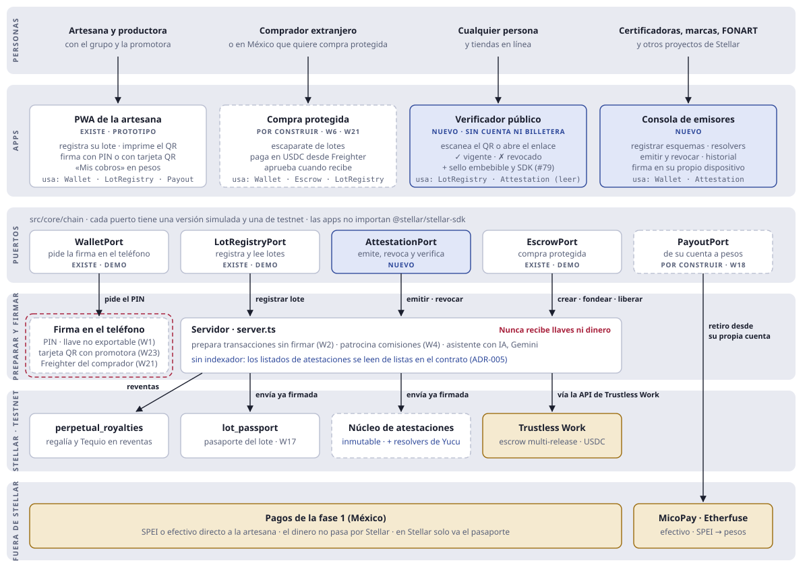

# Arquitectura final de Yucu (propuesta)

* **Estado:** propuesta, octubre de 2026 (revisada el 29 de octubre). Se decide en el [ADR-005](../adr/ADR-005-INFRAESTRUCTURA-DE-ATESTACIONES.md) y el [ADR-007](../adr/ADR-007-MOTOR-DE-ATESTACIONES-POR-VOZ.md), que todavía son borradores. Mientras tanto mandan [`ARCHITECTURE.md`](../ARCHITECTURE.md) y los ADR: si algo de aquí los contradice, manda el ADR.
* **Qué agrega:** las piezas que no estaban contempladas: las atestaciones sobre **Attest Protocol** (base auditada) con un **índice abierto** y las reglas de Yucu como *resolvers*; un **motor de atestaciones por voz y texto** (la IA habla, la persona firma, la cadena prueba); el **verificador público**, la **consola de emisores**, `AttestationPort` y la pantalla de la artesana para sus atestaciones. No hay indexador: las listas viven en el índice.
* **Supuesto abierto:** el diagrama dibuja el verificador y la consola como apps separadas de la PWA de la artesana. La otra opción es una sola PWA con roles.

Leyenda de los diagramas: borde continuo = existe (prototipo o demo) · borde punteado = por construir (issue abierta) · azul = nuevo, no estaba contemplado · amarillo = servicio externo.

## 1. Quién usa qué, y a dónde llega



Las apps solo hablan con los puertos (regla 4 de [`AGENTS.md`](../../AGENTS.md)). Los puertos piden al servidor una transacción sin firmar, la persona la firma en su teléfono y el puerto la envía. El servidor nunca recibe llaves ni dinero. El contrato `fair_escrow` no aparece porque es material didáctico ([ADR-003](../adr/ADR-003-NO-CUSTODIAL-Y-TRUSTLESS-WORK.md)).

## 2. Preparar, firmar en el teléfono, enviar


Sin celular propio, el paso 3 ocurre en el celular de la promotora con la tarjeta QR de la artesana, y la llave se borra al terminar ([ADR-004](../adr/ADR-004-PAGOS-EN-PESOS-SIN-BILLETERA.md), D4).

## 3. Por dónde pasa el dinero


Los porcentajes de comisión, regalía y Tequio salen de [`src/config/protocolFees.ts`](../../src/config/protocolFees.ts) (regla 7). Las disputas las resuelve un tercero de confianza (#103).

## 4. Atestaciones: el motor de Yucu sobre Attest Protocol


Attest Protocol es la base: guarda, revoca y valida, con un contrato auditado que mantienen sus autores. Encima, Yucu agrega lo que no existe: un **índice** sin administrador que cualquier proyecto puede usar (listas por lote, emisor y cuenta, y contadores, sin indexador), las **reglas** de Yucu (quién emite, consentimiento, cofirma) con un administrador multifirma declarado, y el **motor** que lleva de la voz a una atestación firmada por la persona y de vuelta a una respuesta con fuente ([ADR-005](../adr/ADR-005-INFRAESTRUCTURA-DE-ATESTACIONES.md) y [ADR-007](../adr/ADR-007-MOTOR-DE-ATESTACIONES-POR-VOZ.md)). El verificador lee la red directamente, así que su respuesta no depende de confiar en Yucu.

## 5. Cada pieza y sus issues

| Pieza | Estado | Issues |
|---|---|---|
| PWA de la artesana | Existe (prototipo) | W1 #91 · W2 #92 · W3 #93 · W7 #97 · W9 #99 · W20 #114 · W23 #117 · W25 #119 |
| Compra protegida | Por construir | W4 #94 · W6 #96 · W21 #115 · W22 #116 |
| Especificación (formato, manifiesto, vectores) | **Nuevo** | W30 #140 |
| `AttestationPort` | **Nuevo** | W31 #141 |
| Verificador público, con respuestas citadas | **Nuevo** | W32 #142 · reutiliza el widget de #79 |
| Consola de emisores | **Nuevo** | W33 #143 · reutiliza la billetera de W21 |
| Pantalla de la artesana y página de impacto | **Nuevo** | W36 #148 · W37 #151 |
| Índice y reglas de Yucu (*resolvers*) | **Nuevo** | Issue por abrir (ADR-005, D2 y D5) |
| Motor de voz: puerto de IA y extractor por manifiesto | **Nuevo** | W38 #154 · W39 #155 · W42 #158 · extractor genérico por abrir (ADR-007) |
| Servidor MCP | **Nuevo** | Issue por abrir (ADR-007, D5) |
| Attest Protocol | Externo, auditado | Sus issues #126 a #129 (v3) |
| `PayoutPort` | Por construir | W18 #112 |
| Simulado y red | Por construir | W5 #95 · W16 #109 · W24 #118 |
| Servidor | Existe | W2 #92 · W13 #106 · W14 #107 · API de lectura (nuevo) |
| Contratos | Por cambiar | W11 #101 · W17 #110. El `attestation_registry` actual queda como material de práctica y no se redespliega; #100 se cierra (ADR-005, sección 6) |

## 6. Qué cambia respecto a hoy

* Dos apps nuevas para clientes de infraestructura: el verificador público y la consola de emisores.
* Un puerto nuevo, `AttestationPort`, para que esas apps sigan la regla 4.
* Las atestaciones usan Attest Protocol como base y **no se construye un registro propio**. Yucu aporta el índice, sus reglas y los cambios aceptados para v3 (ADR-005, D10).
* No se agrega un indexador: las atestaciones de un lote, un emisor o una cuenta se leen de listas guardadas en el índice (ADR-005, D2).
* El registro por voz se vuelve un motor: cada esquema tiene un manifiesto que dice qué preguntar, qué guardar y qué nunca guardar; la IA prepara y la persona firma (ADR-007).
* Una página pública de impacto muestra cuántas atestaciones hay por esquema, con contadores leídos del contrato; cada emisor ve su propio resumen en la consola.

## 7. Lo que falta antes de mainnet

* Entidad constituida con RFC que cobre la comisión.
* Auditoría independiente de los contratos de Yucu (`lot_passport`, `perpetual_royalties`, el índice y las reglas), con reporte publicado, y especificación con vectores de prueba (ADR-005, sección 4). Attest Protocol ya está auditado.
* Confirmar la conversión a pesos (MXNe a SPEI) y el piloto de MicoPay.
* Piloto de campo con consentimiento y revisión de un abogado ([ADR-004](../adr/ADR-004-PAGOS-EN-PESOS-SIN-BILLETERA.md), sección 5).

## 8. Un solo repositorio: dónde va cada cosa

`yucu-protocol` ya es un monorepo: la PWA, el servidor y los contratos viven juntos. Se mantiene así, sin reorganizar carpetas por ahora (decisión del 29 de octubre de 2026).

**Por qué un solo repositorio**
* Drips Wave aprueba cada repositorio por separado y un repositorio rechazado no se puede volver a postular. Separar piezas sería arriesgar esa aprobación y repartir el historial de los estudiantes.
* El verificador público (#142), la consola de emisores (#143) y la página de impacto (#151) son entradas del mismo proyecto Vite (`verificar.html`, `consola.html`, `impacto.html`) y comparten `src/core/` sin publicar paquetes.
* Un cambio en un puerto, sus pantallas y sus pruebas va en un solo PR, con un solo CI.

**Por qué no se reorganiza ahora**
* Las issues abiertas apuntan a rutas concretas (`src/core/chain/ports.ts`, `server.ts`, `src/components/…`). Mover carpetas obligaría a corregirlas todas.
* Herramientas como Turborepo o Nx agregan configuración que no hace falta con este tamaño.

**Dónde va lo nuevo**

```
yucu-protocol/
├── src/            PWA y entradas de Vite (verificar, consola, impacto). No se mueve.
├── server.ts       Servidor. No se mueve.
├── contracts/      Workspace de Cargo. El índice y las reglas de atestaciones (ADR-005, D2 y D5) entran aquí.
└── packages/       Solo cuando algo se publique para otros proyectos (por ejemplo, un SDK en npm),
                    con npm workspaces, que ya trae Node.
```

**Cuándo revisar esta decisión:** cuando se publique el primer paquete en npm, cuando haya más de un servidor, o cuando el CI tarde tanto que convenga correr solo lo que cambió. Si el índice o el motor necesitan su propio repositorio para que otros los adopten (ADR-005, pregunta 6; ADR-007, pregunta 4), se separa con `git subtree split`, que conserva el historial y los commits de los estudiantes.
