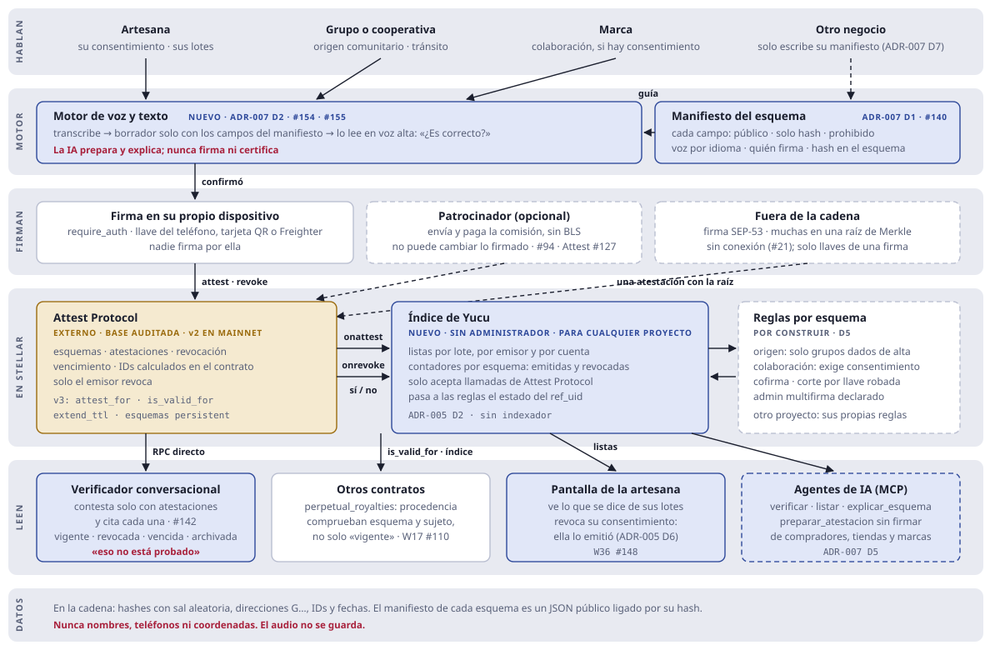

# Arquitectura final de Yucu (propuesta)

* **Estado:** propuesta, octubre de 2026. Se decide en el [ADR-005](../adr/ADR-005-INFRAESTRUCTURA-DE-ATESTACIONES.md), que todavía es un borrador. Mientras tanto mandan [`ARCHITECTURE.md`](../ARCHITECTURE.md) y los ADR: si algo de aquí los contradice, manda el ADR.
* **Qué agrega:** las piezas de infraestructura que no estaban contempladas: una **infraestructura de atestaciones abierta para cualquier proyecto de Stellar** (núcleo genérico más los *resolvers* de Yucu), el **verificador público**, la **consola de emisores**, `AttestationPort` y la pantalla de la artesana para sus atestaciones. No hay indexador: las listas viven en el contrato.
* **Supuesto abierto:** el diagrama dibuja el verificador y la consola como apps separadas de la PWA de la artesana. La otra opción es una sola PWA con roles.

Leyenda de los diagramas: borde continuo = existe (prototipo o demo) · borde punteado = por construir (issue abierta) · azul = nuevo, no estaba contemplado · amarillo = servicio externo.

## 1. Quién usa qué, y a dónde llega


Las apps solo hablan con los puertos (regla 4 de [`AGENTS.md`](../../AGENTS.md)). Los puertos piden al servidor una transacción sin firmar, la persona la firma en su teléfono y el puerto la envía. El servidor nunca recibe llaves ni dinero. El contrato `fair_escrow` no aparece porque es material didáctico ([ADR-003](../adr/ADR-003-NO-CUSTODIAL-Y-TRUSTLESS-WORK.md)).

## 2. Preparar, firmar en el teléfono, enviar


Sin celular propio, el paso 3 ocurre en el celular de la promotora con la tarjeta QR de la artesana, y la llave se borra al terminar ([ADR-004](../adr/ADR-004-PAGOS-EN-PESOS-SIN-BILLETERA.md), D4).

## 3. Por dónde pasa el dinero


Los porcentajes de comisión, regalía y Tequio salen de [`src/config/protocolFees.ts`](../../src/config/protocolFees.ts) (regla 7). Las disputas las resuelve un tercero de confianza (#103).

## 4. Atestaciones: infraestructura abierta para Stellar



El núcleo es genérico y no tiene administrador: lo puede usar cualquier proyecto de Stellar, no solo Yucu. Las reglas de Yucu (quién emite el origen, la cofirma de la artesana, quién revoca) viven en sus *resolvers*, con un administrador multifirma declarado. Antes de construir un núcleo propio se proponen las correcciones a Attest Protocol ([ADR-005](../adr/ADR-005-INFRAESTRUCTURA-DE-ATESTACIONES.md), D10). El verificador lee la red directamente, así que su respuesta no depende de confiar en Yucu.

## 5. Cada pieza y sus issues

| Pieza | Estado | Issues |
|---|---|---|
| PWA de la artesana | Existe (prototipo) | W1 #91 · W2 #92 · W3 #93 · W7 #97 · W9 #99 · W20 #114 · W23 #117 · W25 #119 |
| Compra protegida | Por construir | W4 #94 · W6 #96 · W21 #115 · W22 #116 |
| Verificador público | **Nuevo** | Sin issue todavía. Reutiliza el widget de #79 |
| Consola de emisores | **Nuevo** | Sin issue todavía. Reutiliza la billetera de W21 |
| `AttestationPort` | **Nuevo** | Sin issue todavía (ADR-005, D9) |
| Núcleo de atestaciones y *resolvers* de Yucu | **Nuevo** | Sin issue todavía. Primero, las issues en Attest Protocol (ADR-005, D10) |
| `PayoutPort` | Por construir | W18 #112 |
| Simulado y red | Por construir | W5 #95 · W16 #109 · W24 #118 |
| Servidor | Existe | W2 #92 · W13 #106 · W14 #107 · API de lectura (nuevo) |
| Contratos | Por cambiar | W10 #100 · W11 #101 · W17 #110. El `attestation_registry` actual queda como material de prueba (ADR-005, sección 5) |

## 6. Qué cambia respecto a hoy

* Dos apps nuevas para clientes de infraestructura: el verificador público y la consola de emisores.
* Un puerto nuevo, `AttestationPort`, para que esas apps sigan la regla 4.
* Las atestaciones pasan a una infraestructura abierta para cualquier proyecto de Stellar: un núcleo genérico e inmutable, y las reglas de Yucu en sus propios esquemas y *resolvers*. Antes de construir el núcleo se proponen los cambios a Attest Protocol (ADR-005, D10).
* No se agrega un indexador: las atestaciones de un lote o de un emisor se leen de listas guardadas en el propio contrato (ADR-005, D2).
* Una página pública de impacto muestra cuántas atestaciones hay por esquema, con contadores leídos del contrato; cada emisor ve su propio resumen en la consola.

## 7. Lo que falta antes de mainnet

* Entidad constituida con RFC que cobre la comisión.
* Auditoría independiente de los contratos y del núcleo de atestaciones, con reporte publicado, y especificación con vectores de prueba (ADR-005, sección 4).
* Confirmar la conversión a pesos (MXNe a SPEI) y el piloto de MicoPay.
* Piloto de campo con consentimiento y revisión de un abogado ([ADR-004](../adr/ADR-004-PAGOS-EN-PESOS-SIN-BILLETERA.md), sección 5).

## 8. Un solo repositorio: dónde va cada cosa

`yucu-protocol` ya es un monorepo: la PWA, el servidor y los contratos viven juntos. Se mantiene así, sin reorganizar carpetas por ahora (decisión del 29 de octubre de 2026).

**Por qué un solo repositorio**
* Drips Wave aprueba cada repositorio por separado y un repositorio rechazado no se puede volver a postular. Separar piezas sería arriesgar esa aprobación y repartir el historial de los estudiantes.
* El verificador público (#142), la consola de emisores (#143) y la página de impacto (#151) son entradas del mismo proyecto Vite (`verificar.html`, `consola.html`, `impacto.html`) y comparten `src/core/` sin publicar paquetes.
* Un cambio en un puerto, sus pantallas y sus pruebas va en un solo PR, con un solo CI.

**Por qué no se reorganiza ahora**
* Las issues abiertas apuntan a rutas concretas (`src/core/chain/ports.ts`, `server.ts`, `src/components/…`). Mover carpetas obligaría a corregirlas todas.
* Herramientas como Turborepo o Nx agregan configuración que no hace falta con este tamaño.

**Dónde va lo nuevo**

```
yucu-protocol/
├── src/            PWA y entradas de Vite (verificar, consola, impacto). No se mueve.
├── server.ts       Servidor. No se mueve.
├── contracts/      Workspace de Cargo. Si se construye el núcleo de atestaciones (ADR-005, D10), entra aquí.
└── packages/       Solo cuando algo se publique para otros proyectos (por ejemplo, un SDK en npm),
                    con npm workspaces, que ya trae Node.
```

**Cuándo revisar esta decisión:** cuando se publique el primer paquete en npm, cuando haya más de un servidor, o cuando el CI tarde tanto que convenga correr solo lo que cambió. Si el núcleo de atestaciones necesita su propio repositorio para que otros lo adopten (ADR-005, pregunta 5), se separa con `git subtree split`, que conserva el historial y los commits de los estudiantes.
