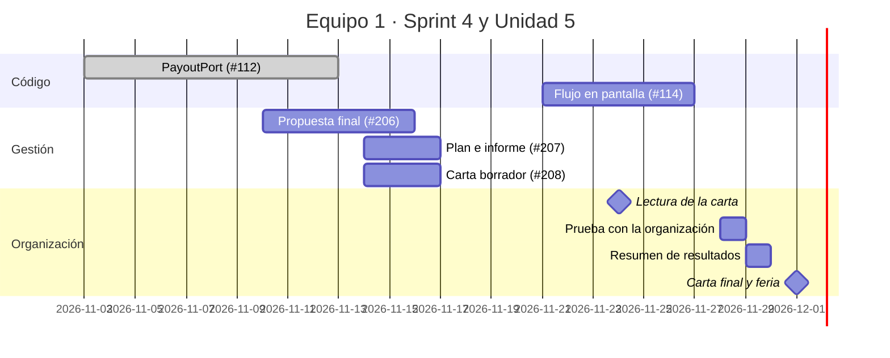

# Propuesta final · Equipo 1

**Módulo:** cobro en pesos desde la cuenta de la artesana: puerto `PayoutPort` ([#112](https://github.com/Open-Hub-Tec/yucu-protocol/issues/112), ya fusionado en el PR [#239](https://github.com/Open-Hub-Tec/yucu-protocol/pull/239)) y su flujo en pantalla "Ya estoy en la tienda" ([#114](https://github.com/Open-Hub-Tec/yucu-protocol/issues/114)).
**Organización:** Colectivo de Artesanas Textiles de la Mixteca Alta `[DATOS DE EJEMPLO / SIMULADOS]`
**Equipo (4 integrantes):** @nallely-lopez (eduScrum Master), @Ab396, @LeninBautistaaa, @Dani0GO
**Issue:** [#197](https://github.com/Open-Hub-Tec/yucu-protocol/issues/197) · Sub-issue [#206](https://github.com/Open-Hub-Tec/yucu-protocol/issues/206)

> **Aviso de datos de ejemplo (simulados).** Lo marcado `[DATOS DE EJEMPLO / SIMULADOS]` son datos de referencia que autorizó el docente: en los Sprints 1 a 3 el equipo trabajó un caso distinto y todavía no hay validación en campo con una organización productora. No hay nombres reales, teléfonos ni documentos privados ([PRIVACIDAD.md](../../research/PRIVACIDAD.md)).

> Yucu es un **prototipo** en red de prueba (testnet). Nada de lo que aquí se describe está en uso real con dinero ni ha sido revisado por una auditoría externa.

## Resumen ejecutivo

**Problema.** Las socias del colectivo cobran en efectivo cada 3 a 4 semanas, y cuando venden por fuera el intermediario se queda con la mayor parte. Ir al banco a cobrar les cuesta medio día y $60 de pasaje `[DATOS DE EJEMPLO / SIMULADOS]`.

**Solución.** Un flujo en la app Yucu para que la artesana cobre en pesos, en efectivo, **desde su propia cuenta** y sin esperar a nadie. Cuando ya está en la tienda, elige la tienda, firma con su PIN (o con su tarjeta QR en el celular de la promotora) y recibe un código de cobro que vale 15 minutos. Si no lo cobra, el dinero regresa a su cuenta.

**Quién se beneficia.** Las 14 socias del colectivo `[DATOS DE EJEMPLO / SIMULADOS]` y su persona de confianza (promotora).

**Costo total:** $17,880 MXN: $17,280 de 144 horas de trabajo de estudiantes, más $600 de pasajes e impresiones que cubre el equipo. La organización no paga nada.
**Fecha de entrega:** 1 de diciembre de 2026 (Feria de Integración).

## Problema y contexto

Todo lo de esta sección es de referencia `[DATOS DE EJEMPLO / SIMULADOS]`: el equipo todavía no ha visitado a la organización. La primera visita será la lectura de la carta, el 24 de noviembre, y ahí se validarán estos datos. Las personas aparecen solo por su rol, según [PRIVACIDAD.md](../../research/PRIVACIDAD.md).

- **Organización:** Colectivo de Artesanas Textiles de la Mixteca Alta, grupo de artesanas textiles cerca de Tlaxiaco.
- **Citas de referencia:**
  - > "Para nosotras es más fácil mandar una nota de voz que llenar formatos en el teléfono." — artesana
  - > "Cuando vendemos por fuera, el intermediario se queda con la mayor parte y no saben quién lo tejió." — representante del grupo
  - > "Preferimos recibir el pago en efectivo en la comunidad porque ir hasta el banco nos quita medio día y dinero de pasaje." — artesana

| Indicador | Dato de referencia |
|---|---|
| Tamaño del grupo | 14 socias activas |
| Cómo y cada cuándo cobran | En efectivo contra entrega, cada 3 a 4 semanas |
| Distancia y costo para cobrar | Unos 45 minutos de traslado; $60 MXN el viaje redondo a la cabecera municipal |
| Acceso a celular | 9 de 14 socias tienen teléfono propio; 5 comparten uno con su familia |

## Objetivo SMART y alcance

**Objetivo SMART** <!-- TODO: revisar contra el objetivo del Sprint 3 -->

| Letra | Cómo se cumple |
|---|---|
| **S** (específico) | Una artesana completa, en la versión simulada de Yucu, el flujo "Ya estoy en la tienda": elige la tienda, firma y obtiene su código de cobro de 15 minutos. |
| **M** (medible) | Al menos 3 de 5 socias voluntarias completan el flujo sin ayuda en menos de 5 minutos durante la prueba con la organización. |
| **A** (alcanzable) | El puerto `PayoutPort` y su versión simulada ya están hechos y probados (PR #239); falta la pantalla (#114). |
| **R** (relevante) | Responde al problema de la sección 2: cobrar sin intermediarios, sin viajar a Tlaxiaco y sin depender de otra persona. |
| **T** (temporal) | Listo y probado con la organización antes del 1 de diciembre de 2026. |

**El módulo incluye:**
- Puerto `PayoutPort` (`quote`, `prepareCashout`, `submit`, `getStatus`) con versión simulada y pruebas (#112, terminado).
- Pantallas del flujo "Ya estoy en la tienda" para personas mayores: botones de 56 px o más, textos de máximo dos renglones (#114).
- Firma con PIN o con tarjeta QR; el código de cobro no se guarda en el teléfono.
- Regreso del dinero a la cuenta de la artesana si el código vence.
- Respeto del límite por cobro de #91.

**No incluye (fuera del alcance):**
- Conexión real con proveedores de efectivo (MicoPay) o SPEI (Etherfuse): eso son otras issues (#145, #146).
- Uso con dinero real o en red principal (mainnet).
- Registro de lotes, catálogo o escrow.
- Garantía de ventas o ingresos.

## Solución y uso de Stellar

**Qué se construye.** El cobro en pesos pasa por un puerto (`PayoutPort`, en `src/core/chain/ports.ts`) para que la pantalla no dependa del proveedor ([ADR-004](../../adr/ADR-004-PAGOS-EN-PESOS-SIN-BILLETERA.md), D9). Sigue el patrón obligatorio de Yucu: **preparar → firmar en el teléfono → enviar**. El servidor nunca toca llaves ni dinero ([ADR-003](../../adr/ADR-003-NO-CUSTODIAL-Y-TRUSTLESS-WORK.md)).

**Por qué ayuda Stellar.**
- El dinero de la venta llega directo a la cuenta de la artesana, sin que el grupo ni Yucu lo retengan.
- Comisiones de red muy bajas y confirmación en segundos.
- Red de puntos de cobro en efectivo (anclas como MicoPay) que convierte el saldo en pesos.
- La artesana nunca ve cripto: solo ve el monto en pesos (ADR-004).

**Qué es real, qué es demostración y qué está pendiente** (según la tabla de estado del [README](https://github.com/Open-Hub-Tec/yucu-protocol#implementation-status)):

| Parte | Estado |
|---|---|
| `PayoutPort` y `SimulatedPayout` con pruebas | ✅ Real como código; los resultados son simulados (`source: 'simulated'`) |
| Pantalla "Ya estoy en la tienda" (#114) | ⏳ Pendiente, Unidad 5 |
| Cotización en pesos, código de cobro y su vencimiento | 🟡 Demostración: la versión simulada los inventa y la app muestra `<DemoBadge />` |
| Conexión con MicoPay / Etherfuse | ⏳ Pendiente (otras issues) |
| Dinero real o mainnet | ❌ No está en el alcance |

## Plan de trabajo y cronograma

| # | Entregable | Cómo se verifica | Fecha | Responsable |
|---|---|---|---|---|
| E1 | `PayoutPort` + versión simulada + pruebas (#112) | PR #239 fusionado; `npm test` en verde | 2026-11-13 | @Ab396 |
| E2 | Propuesta final (#206) | PR con `Resolves #206` aprobado | 2026-11-16 | @nallely-lopez |
| E3 | Plan de informe e informe semana 1 (#207) | PR con `Resolves #207` aprobado | 2026-11-17 | @Dani0GO |
| E4 | Borrador de carta de entendimiento (#208) | PR `Refs #208` revisado por el Equipo 3 | 2026-11-17 | @nallely-lopez |
| E5 | Lectura de la carta a la organización, en lenguaje sencillo | Minuta de la sesión en `minutas/` | 2026-11-24 | @nallely-lopez |
| E6 | Pantallas del flujo "Ya estoy en la tienda" (#114) | PR con pruebas: flujo feliz, vencimiento, PIN equivocado, código no guardado | 2026-11-27 | @LeninBautistaaa |
| E7 | Prueba del flujo con la organización | Minuta en `minutas/` con resultados | 2026-11-28 | @Dani0GO |
| E8 | Resumen de resultados para la organización | Hoja impresa de una página y nota de voz; su texto queda en el informe semanal | 2026-11-30 | @Dani0GO |
| E9 | Carta final (#208) | PR `Resolves #208` con estado y minuta | 2026-12-01 | @nallely-lopez |
| E10 | Presentación en la Feria de Integración | Demo en vivo con la versión simulada | 2026-12-01 | @Ab396 |

**Costo total del plan:** $17,880 MXN (detalle en la sección siguiente).

## Presupuesto y personal

**Tarifa por hora:** $120 MXN. Es una tarifa de referencia de desarrollador junior en México: un sueldo mensual aproximado de $19,200 MXN entre 160 horas al mes. <!-- TODO: citar la fuente que usen (bolsa de trabajo o encuesta salarial) -->

**Horas y costo por entregable, y quién pone las horas**

Cada renglón suma las horas de los cuatro integrantes, y cada columna da las horas de esa persona.

| Entregable | Horas | Costo | @nallely-lopez | @Ab396 | @LeninBautistaaa | @Dani0GO |
|---|---|---|---|---|---|---|
| E1 · PayoutPort (#112) | 20 | $2,400 | 0 | 20 | 0 | 0 |
| E2 · Propuesta final | 12 | $1,440 | 6 | 0 | 3 | 3 |
| E3 · Plan e informe | 10 | $1,200 | 0 | 0 | 4 | 6 |
| E4 · Borrador de carta | 6 | $720 | 6 | 0 | 0 | 0 |
| E5 · Lectura de la carta (4 × 4 h, incluye traslado) | 16 | $1,920 | 4 | 4 | 4 | 4 |
| E6 · Flujo en pantalla (#114) | 30 | $3,600 | 6 | 5 | 12 | 7 |
| E7 · Prueba con la organización (4 × 4 h, incluye traslado) | 16 | $1,920 | 4 | 4 | 4 | 4 |
| E8 · Resumen de resultados | 3 | $360 | 0 | 0 | 0 | 3 |
| E9 · Carta final | 4 | $480 | 4 | 0 | 0 | 0 |
| E10 · Feria de Integración (4 × 3 h) | 12 | $1,440 | 3 | 3 | 3 | 3 |
| Calidad · prevención (guía de revisión, criterios de aceptación) | 4 | $480 | 1 | 0 | 1 | 2 |
| Calidad · evaluación (revisión de PR, revisión cruzada, pruebas) | 7 | $840 | 2 | 0 | 3 | 2 |
| Calidad · fallas (retrabajo después de revisiones) | 4 | $480 | 0 | 0 | 2 | 2 |
| **Total en horas de trabajo** | **144** | **$17,280** | **36** | **36** | **36** | **36** |

**Costo de calidad.** Las tres filas de "Calidad" son una estimación de referencia `[DATOS DE EJEMPLO / SIMULADOS]`, porque el Plan de Calidad del Sprint 2 fue para el caso anterior. <!-- TODO: si el docente lo pide, cambiar por el monto del Plan de Calidad del Sprint 2 --> Suman 15 horas y $1,800, el 11.6 % de las 129 horas de trabajo directo.
- **Prevención:** escribir la guía de revisión y los criterios de aceptación antes de programar.
- **Evaluación:** revisar los PR, la revisión cruzada del Equipo 3 y las pruebas automáticas.
- **Fallas:** corregir lo que salga en las revisiones.

**Gastos en dinero** `[DATOS DE EJEMPLO / SIMULADOS]`

| Gasto | Cálculo | Costo |
|---|---|---|
| Pasajes a la comunidad (lectura de la carta y prueba) | 4 personas × 2 visitas × $60 viaje redondo | $480 |
| Impresiones (carta para leer, hojas con las pantallas, resumen de resultados) | 40 hojas × $3 | $120 |
| **Total de gastos** | | **$600** |

**Total del proyecto: $17,880 MXN** ($17,280 en horas + $600 en gastos).

**Quién lo paga.** La organización no paga nada. Las horas las ponen los estudiantes como parte de la materia, así que no son un pago de verdad: se cuentan para saber cuánto valdría el trabajo. Los $600 de gastos los pone el equipo ($150 por integrante). El proyecto no necesita financiamiento externo.

## Riesgos y viabilidad

**Dictamen:** Go condicionado. <!-- TODO: si en el Sprint 3 decidieron otra cosa, usen esa -->

**Justificación:** el costo total es de $17,880 MXN. De eso, $17,280 son horas de estudiantes dentro de la materia, que no se pagan con dinero. Solo $600 son gastos reales (pasajes e impresiones), y el equipo puede cubrirlos. No hace falta financiamiento externo y la organización no paga nada. La parte más difícil, el puerto `PayoutPort`, ya está terminada (PR #239). Seguimos con dos condiciones:
1. Que la organización escuche la carta el 24 de noviembre y acepte hacer la prueba.
2. Que las pantallas de #114 estén terminadas el 27 de noviembre. Si no, la prueba se hace con un prototipo en papel.

| Riesgo | Probabilidad | Impacto | Respuesta | Dueño |
|---|---|---|---|---|
| Si no hay señal en la comunidad el día de la prueba, entonces no se puede mostrar el flujo en vivo. | Alta | Medio | Llevar la app instalada (PWA) con la versión simulada, que funciona sin conexión, y una hoja impresa con las pantallas. | @Dani0GO |
| Si la asamblea necesita más tiempo para consultar la carta, entonces no estará firmada el 1 de diciembre. | Media | Bajo | No apresurar la firma; entregar con estado "en consulta de asamblea", minuta y fecha de la siguiente reunión. | @nallely-lopez |
| Si las pantallas de #114 no quedan antes de la prueba, entonces la organización no puede probar el flujo completo. | Media | Alto | Priorizar el flujo feliz y probar con un prototipo en papel. | @LeninBautistaaa |
| Si las artesanas no entienden el código de cobro de 15 minutos, entonces podrían perder el cobro. | Media | Medio | Probar los textos con ellas y mostrar el tiempo restante en grande; si vence, el dinero regresa a su cuenta. | @Dani0GO |
| Si el código de cobro queda guardado en el celular de la promotora (cuando la artesana firma con su tarjeta QR), entonces otra persona podría cobrarlo. | Baja | Alto | No guardar el código en IndexedDB, `localStorage`, la caché ni el historial; borrarlo al salir de la pantalla, y comprobarlo con una prueba automática (lo pide #114). | @LeninBautistaaa |
| Si la pantalla no respeta el límite por cobro de #91, entonces el PR de #114 no se fusiona. | Media | Medio | Incluir el límite en el alcance y agregar una prueba con un monto mayor al límite. | @Ab396 |

## Evidencia y siguientes pasos

**Evidencia que se puede revisar**
- Código del módulo: PR [#239](https://github.com/Open-Hub-Tec/yucu-protocol/pull/239) (`PayoutPort`, fusionado el 13 de noviembre de 2026) y pruebas en [`src/tests/chain_ports.test.ts`](https://github.com/Open-Hub-Tec/yucu-protocol/blob/main/src/tests/chain_ports.test.ts).
- Entregas de los Sprints 1 a 3 (corresponden al caso anterior del curso, antes de integrarse a Yucu):
  - Sprint 1: enlace pendiente <!-- TODO: pegar enlace real de Classroom, Drive o issue -->
  - Sprint 2: enlace pendiente <!-- TODO: pegar enlace real -->
  - Sprint 3: enlace pendiente <!-- TODO: pegar enlace real -->
- Primer contacto con la organización: mensaje a la presidenta del comité, 20 de noviembre de 2026 `[DATOS DE EJEMPLO / SIMULADOS]` (texto en el [informe de la semana 1](./informe-semana-1.md)).
- Prototipo: las pantallas de #114 se construyen en la Unidad 5.
- Tablero: [Yucu Delivery Roadmap](https://github.com/orgs/Open-Hub-Tec/projects/1), filtrado por el Equipo 1 <!-- TODO: cambiar por el tablero propio del equipo si tienen uno -->.
- Carta de entendimiento: [`carta.md`](./carta.md), estado: borrador.

**Siguientes pasos**

| Paso | Fecha | Responsable |
|---|---|---|
| Aplicar a #114 en la app de Drips (un comentario en GitHub no cuenta) y abrir la rama cuando nos la asignen | 2026-11-21 | @LeninBautistaaa |
| Leer la carta a la organización | 2026-11-24 | @nallely-lopez |
| Prueba del flujo con la organización | 2026-11-28 | @Dani0GO |
| Entregar el resumen de resultados a la organización | 2026-11-30 | @Dani0GO |
| Carta final y presentación en la Feria de Integración | 2026-12-01 | @nallely-lopez, @Ab396 |

## Ética y datos personales

- Seguimos el aviso de privacidad del repositorio: [PRIVACIDAD.md](../../research/PRIVACIDAD.md). En este documento no hay nombres, voces, fotos, teléfonos ni números de control; las personas de la comunidad aparecen solo por rol y comunidad, y los integrantes solo con su `@usuario`.
- El puerto `PayoutPort` no recibe ni devuelve nombres de personas ni llaves secretas.
- Esta propuesta **no promete** ventas, ingresos ni certificaciones. Yucu es un prototipo en red de prueba: no se usa con dinero real ni tiene revisión de seguridad externa.
