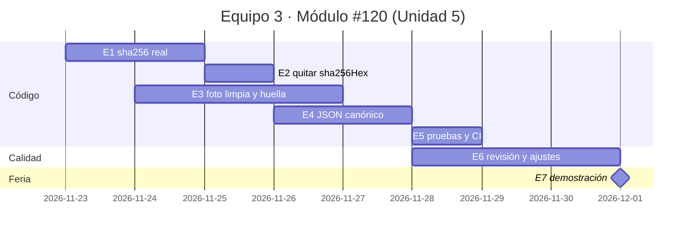

# Propuesta Final · Equipo 3

**Módulo:** [#120](https://github.com/Open-Hub-Tec/yucu-protocol/issues/120) · CryptoEngine: SHA-256 real, sin respaldo falso y huella de la foto completa
**Sub-issue:** [#212](https://github.com/Open-Hub-Tec/yucu-protocol/issues/212) · Issue padre: [#199](https://github.com/Open-Hub-Tec/yucu-protocol/issues/199)
**Organización:** Yosondua (Mixteca de Oaxaca)
**eduScrum Master:** @IsaiasBrayanLopez · **Integrantes:** @AlexViva-0, @IsaiasBrayanLopez, @Jazlynn22

> **Nota sobre el módulo.** El texto de #199 describe el módulo como "la pantalla de entrevista ya no guarda nombres ni teléfonos", que es el título de #121 (asignada al Equipo 8). El número que trae #199 y el comentario del Product Owner en #120 asignan al Equipo 3 la issue **#120**, así que esta propuesta trabaja #120. El equipo lo confirmará con el Product Owner al pedir la asignación (sección 8).

> Esta propuesta es de un **prototipo** en Stellar testnet. No promete ventas, ingresos ni certificaciones.

## 1. Resumen ejecutivo

**Problema.** Cuando una productora registra un lote en Yucu, la app calcula una "huella" (hash) del lote y de su foto para que un comprador compruebe después que nada cambió. Hoy esa huella no es confiable: `sha256Hex()` no es SHA-256, la huella de la foto solo usa sus primeros 100 caracteres y además incluye el nombre de la productora y su comunidad, lo que permite adivinar de quién es. La foto también puede llevar la ubicación GPS de la casa de la artesana.

**Solución.** Reemplazar el cálculo por SHA-256 real con WebCrypto (sin dependencias nuevas), calcular la huella sobre la foto completa ya limpia de GPS y metadatos, y armar la huella del lote con JSON canónico sin nombres ni comunidad exacta.

**Quién se beneficia.** La organización Yosondua, porque la prueba de origen de sus lotes no se puede falsificar fácilmente y no expone dónde viven sus integrantes; y los compradores, que pueden verificar la huella.

**Costo y fecha.** 44 horas del equipo, **$6,600 MXN** (costo de referencia; la organización no paga nada). Entrega en la Feria de Integración el **1 de diciembre** de 2026 (2026-12-01).

## 2. Problema y contexto

**El problema técnico (verificable en el repositorio).** En `src/core/crypto/CryptoEngine.ts`:

1. `sha256Hex()` es un hash de 53 bits rellenado con ceros hasta 64 caracteres. Lo usan `src/core/ai/RaizAIOracles.ts` (4 usos) y `src/core/sdk/RaizProtocolSDK.ts` (1 uso). Se pueden encontrar dos entradas distintas con la misma "huella" con poco esfuerzo.
2. `computeSha256()` usa ese mismo cálculo como respaldo cuando no hay WebCrypto y lo devuelve como si fuera SHA-256 (rompe la regla 3 de `AGENTS.md`).
3. `generateCommunityDigest()` solo toma los primeros 100 caracteres de la foto y el audio en base64: casi toda la foto puede cambiar sin que cambie la huella.
4. La huella incluye `producerName` y `community`. Como hay pocos nombres posibles, cualquiera puede adivinar de quién es una huella ([ADR-004](https://github.com/Open-Hub-Tec/yucu-protocol/pull/104), D5).
5. Una foto tomada con el teléfono puede llevar la ubicación GPS de la casa de la artesana ([`BASE_DE_DATOS.md`](../../arquitectura/BASE_DE_DATOS.md), sección 5).

**Por qué le importa a Yosondua.** Yucu existe para que productores y artesanas de la Mixteca registren sus lotes, prueben su origen y vendan sin intermediarios ([`AGENTS.md`](../../../AGENTS.md)). El ejemplo de registro del propio proyecto es justamente un lote de Yosondúa: la persona dice "Tengo 20 kilos de café de Yosondúa" y la app guarda la huella de ese lote ([`ARCHITECTURE.md`](../../ARCHITECTURE.md), Fase 1). Esa huella es lo único que un comprador puede revisar para confiar en el origen, así que:

- si la huella es débil, alguien puede presentar un lote falso como si fuera de Yosondua y la organización pierde la confianza que la prueba de origen debería darle;
- si la huella incluye nombres o la comunidad exacta, se puede adivinar quién registró cada lote, en contra del aviso de privacidad ([`PRIVACIDAD.md`](../../research/PRIVACIDAD.md));
- si la foto lleva GPS, se puede saber dónde vive o trabaja la persona que la tomó.

## 3. Objetivo SMART y alcance

**Objetivo.** Para el **1 de diciembre** de 2026, el Equipo 3 entregará en un PR aprobado un `CryptoEngine` que calcula SHA-256 real con WebCrypto, comprobado con **2 vectores oficiales** y **al menos 4 pruebas** nuevas (positivas y negativas), con **0 usos** de `sha256Hex` en el repositorio y **0 dependencias** nuevas, presentado en la Feria de Integración.

| Letra | Cómo se cumple |
|---|---|
| **S** (específico) | Un solo módulo: `src/core/crypto/CryptoEngine.ts` y sus usos. |
| **M** (medible) | 2 vectores oficiales pasan; 4 pruebas nuevas; `git grep sha256Hex` sin resultados; `npm run lint`, `npm test` y `npm run build` pasan. |
| **A** (alcanzable) | 44 horas entre 3 integrantes (14 a 16 h cada uno) en una semana; WebCrypto ya existe en el navegador y en Node 22. |
| **R** (relevante) | Sin una huella real, la prueba de origen de los lotes de la organización no vale nada y además puede exponer quién es y dónde vive. |
| **T** (temporal) | Código del 23 al 28 de noviembre; PR aprobado el 2026-11-30; demostración el 2026-12-01. |

**El módulo incluye:**
- Función `sha256(data: Uint8Array | ArrayBuffer | string): Promise<string>` con `crypto.subtle.digest`; sin WebCrypto lanza un error.
- Eliminar `sha256Hex()` y cambiar sus 5 usos por la versión asíncrona; donde el motor sea simulado, el resultado lleva `source: 'simulated'`.
- Huella de la foto sobre sus bytes completos, después de redibujarla en un `canvas` y guardarla como JPEG para quitar GPS, modelo del teléfono y fecha.
- Huella del lote con JSON canónico (llaves ordenadas) con los campos de `RegisterLotRequest`, sin nombres ni comunidad exacta.
- Actualizar `complete_system_audit.test.ts` y `dynamic_process.test.ts`.

**El módulo no incluye** (fuera del alcance):
- Registrar la huella en la cadena (contratos Soroban, #110 y #93).
- Firmar lotes con la billetera de la productora (#91, #105).
- Cambiar el motor de voz o la IA (#154, #155).
- Despliegue en mainnet o revisión de seguridad externa.

## 4. Solución y uso de Stellar

**Qué se construye (en lenguaje sencillo).** Una herramienta que genera un sello o «huella digital» única para cada lote que registra la productora. Si alguien intenta alterar la foto del producto o modificar los datos del lote (como el peso o el origen), la huella cambia por completo y la alteración se nota de inmediato. Además, cuando termine E3, la aplicación borrará de la foto datos ocultos como las coordenadas GPS antes de calcular la huella, para que nadie pueda rastrear la ubicación de la casa o taller de la artesana.

**Por qué ayuda Stellar (en palabras claras).** Stellar funciona como una libreta pública y permanente que nadie puede alterar ni borrar. En esa libreta se anota únicamente la huella digital del lote, jamás las fotos, nombres ni datos personales ([ADR-006](../../adr/ADR-006-DATOS-FUERA-DE-LA-CADENA-E-IA.md)). De esta manera, cuando el registro en Stellar esté listo, cualquier comprador podrá comprobar que la foto y los datos no cambiaron, protegiendo siempre la privacidad de la comunidad y sin que nadie custodie las llaves ni el dinero de la organización ([ADR-003](../../adr/ADR-003-NO-CUSTODIAL-Y-TRUSTLESS-WORK.md)).

**Qué es real, qué es demostración y qué está pendiente** (según la tabla "Qué es real y qué es simulado" del [`README.md`](../../../README.md#implementation-status)):

| Parte | Estado | Detalle |
|---|---|---|
| SHA-256 con WebCrypto (este módulo) | ✅ Real al terminar | Cálculo estándar, comprobado con vectores oficiales. |
| Limpieza de GPS de la foto (este módulo) | ✅ Real al terminar | Se hace en el teléfono antes de calcular la huella. |
| Contratos Soroban | ✅ Real, testnet | No en mainnet; redespliegue pendiente (#110). |
| `RaizAIOracles.ts`, `RaizProtocolSDK.ts` | 🔴 Simulado | Usarán el SHA-256 real, pero sus resultados siguen marcados `source: 'simulated'`. |
| Registro de la huella en la cadena | ⏳ Pendiente | Issues #93 y #110; no es parte de este módulo. |

## 5. Plan de trabajo y cronograma

| # | Entregable | Cómo se verifica | Fecha | Responsable | Horas |
|---|---|---|---|---|---|
| E1 | `sha256()` con WebCrypto y error si no existe | Pruebas con los vectores oficiales de `""` y `"abc"`; prueba negativa sin WebCrypto | 2026-11-24 | @AlexViva-0 | 8 |
| E2 | `sha256Hex()` eliminado y sus 5 usos migrados con `source: 'simulated'` | 5 usos migrados a `sha256()` asíncrono (4 en `RaizAIOracles.ts` y 1 en `RaizProtocolSDK.ts`); `git grep sha256Hex` con 0 coincidencias; `npm test` pasa | 2026-11-25 | @IsaiasBrayanLopez | 8 |
| E3 | Foto limpia (sin GPS ni metadatos EXIF) y huella sobre sus bytes completos | Prueba unitaria: una foto procesada en canvas se genera sin etiquetas EXIF/GPS; la huella cubre el 100 % de los bytes del archivo y cualquier byte alterado cambia la huella por completo (efecto avalancha) | 2026-11-26 | @Jazlynn22 | 8 |
| E4 | Huella del lote con JSON canónico, sin nombres | Prueba: el mismo lote con llaves en otro orden da la misma huella | 2026-11-27 | @AlexViva-0 | 6 |
| E5 | Pruebas viejas actualizadas y verificación completa | `complete_system_audit.test.ts` y `dynamic_process.test.ts` actualizadas sin campos `producerName` ni `community` en la firma; `npm run lint`, `npm test` y `npm run build` pasan en verde en CI | 2026-11-28 | @IsaiasBrayanLopez | 4 |
| E6 | Calidad: revisión cruzada del PR, verificación de rúbrica y correcciones | Checklist de calidad del Sprint 2 cumplido; revisión técnica entre pares en GitHub con comentarios sustantivos y aprobación formal del PR | 2026-11-30 | @Jazlynn22 | 6 |
| E7 | Demostración en la Feria de Integración | Demostración técnica en vivo: (1) vectores oficiales en consola, (2) efecto avalancha al cambiar 1 byte de la foto, (3) comprobación de foto limpia de EXIF/GPS; cada integrante expone su parte | 2026-12-01 | @IsaiasBrayanLopez | 4 |

## 6. Presupuesto y personal

Tarifa de referencia: **$150 MXN por hora**. Es un costo de referencia para medir el esfuerzo: es trabajo de clase y **la organización no paga nada**.

**Costo por entregable**

| Entregable | Horas | Tarifa | Costo |
|---|---:|---:|---:|
| E1 `sha256()` real | 8 | $150 | $1,200 |
| E2 quitar `sha256Hex()` | 8 | $150 | $1,200 |
| E3 foto limpia y huella completa | 8 | $150 | $1,200 |
| E4 JSON canónico | 6 | $150 | $900 |
| E5 pruebas y CI | 4 | $150 | $600 |
| E6 costo de la calidad (Sprint 2): revisión y correcciones | 6 | $150 | $900 |
| E7 demostración en la Feria | 4 | $150 | $600 |
| **Total** | **44** | | **$6,600 MXN** |

El costo de la calidad sigue las categorías del Plan de Calidad del Sprint 2: **prevención** (pruebas con vectores oficiales antes de cerrar cada entregable, cubiertas en las horas de E1 a E5) y **evaluación y corrección** (E6: revisión técnica cruzada del PR y atención de observaciones, 6 h, $900 MXN, a cargo de @Jazlynn22). Detectar una discrepancia en la huella o una fuga de metadatos antes de anclar en Stellar cuesta unas pocas horas de revisión; detectarlo después no tiene solución posible, ya que los registros en la cadena son inmutables.

**Personal** (las horas por integrante suman el total)

| Integrante | Rol | Entregables | Horas |
|---|---|---|---:|
| @AlexViva-0 | Desarrollo | E1, E4 | 14 |
| @IsaiasBrayanLopez | eduScrum Master, migración criptográfica y facilitador de demo | E2, E5, E7 | 16 |
| @Jazlynn22 | Desarrollo y calidad | E3, E6 | 14 |
| **Total** | | | **44** |

## 7. Riesgos y viabilidad

**Dictamen: Go condicionado.**
- **Viabilidad económica y financiera:** El costo estimado de $6,600 MXN (44 horas a $150 MXN/h) corresponde al valor de referencia del tiempo de desarrollo académico del equipo. No requiere financiamiento externo y la organización comunitaria Yosondua no absorbe costo alguno; el financiamiento realista disponible ($0 MXN de capital monetario, 100% cubierto por horas de clase y laboratorio) es completamente suficiente.
- **Viabilidad técnica:** El alcance es viable en una semana ya que `crypto.subtle` es nativo en navegadores modernos y Node 22, no requiere paquetes externos adicionales y respeta los principios no custodiales y de privacidad de `AGENTS.md`.
- **Condiciones para pasar a Go definitivo:**
  1. Que el Product Owner confirme la aclaración entre #199/#121 y asigne formalmente la issue #120 al Equipo 3 antes del 23 de noviembre.
  2. Que la revisión cruzada de pares en el PR #340 resulte aprobada sin observaciones bloqueantes.

| # | Riesgo (si… entonces…) | Probabilidad | Impacto | Respuesta | Dueño |
|---|---|---|---|---|---|
| R1 | Si un teléfono viejo de la organización no tiene WebCrypto, entonces la app no podrá calcular la huella en ese teléfono. | Baja | Alto | Mitigar: la función lanza un error claro y la app avisa que no se puede registrar el lote; nunca devuelve una huella falsa. Se prueba en un teléfono de gama baja. | @AlexViva-0 |
| R2 | Si quitar `sha256Hex()` rompe pruebas de `RaizAIOracles` o del SDK, entonces el PR no pasa CI y se retrasa E2. | Media | Medio | Mitigar: migrar un uso a la vez con `npm test` después de cada cambio; reservar 2 horas de E6. | @IsaiasBrayanLopez |
| R3 | Si redibujar la foto en `canvas` da bytes distintos en cada navegador, entonces la prueba de "misma foto, misma huella" puede fallar. | Media | Medio | Mitigar y documentar: estandarizar la exportación a JPEG con compresión fija, calculando la huella SHA-256 una sola vez inmediatamente después de limpiar la imagen en el dispositivo y guardando esa versión idéntica para comprobaciones posteriores. | @Jazlynn22 |
| R4 | Si un integrante presenta indisponibilidad en la semana del 23 de noviembre, entonces se compromete la ruta crítica hacia la Feria. | Media | Alto | Mitigar: el eduScrum Master reasigna las tareas críticas en el daily hacia los integrantes disponibles, priorizando E1/E3/E5, y notifica al Product Owner de inmediato en el standup sin demoras. | @IsaiasBrayanLopez |

## 8. Evidencia y siguientes pasos

**Evidencia revisable**

| Evidencia | Dónde | Estado |
|---|---|---|
| Implementación en repositorio | [PR #341](https://github.com/Open-Hub-Tec/yucu-protocol/pull/341) | ✅ Fusionado el 2026-11-23 en `main`: implementó SHA-256 real, huella de la foto completa y JSON canónico; la limpieza de GPS (parte de E3) sigue pendiente |
| Issue del módulo | [#120](https://github.com/Open-Hub-Tec/yucu-protocol/issues/120) | Cerrada por PR #341; limpieza de GPS y metadatos se entrega el 2026-11-26 |
| Código actual | [`src/core/crypto/CryptoEngine.ts`](../../../src/core/crypto/CryptoEngine.ts) | SHA-256 real con WebCrypto activo; pendiente incorporar la limpieza de metadatos EXIF/GPS |
| Prototipo de Yucu (PWA) | [`README.md`](../../../README.md#quickstart), sección Quickstart | 🟡 Prototipo; se ejecuta con `npm run dev` según el Quickstart |
| Pruebas de la huella | [`complete_system_audit.test.ts`](../../../src/tests/complete_system_audit.test.ts), [`dynamic_process.test.ts`](../../../src/tests/dynamic_process.test.ts) | Actualizadas en #341 con JSON canónico |
| Plan de informe | [#213](https://github.com/Open-Hub-Tec/yucu-protocol/issues/213) | [PR #369](https://github.com/Open-Hub-Tec/yucu-protocol/pull/369) en revisión |
| Carta de entendimiento | [#214](https://github.com/Open-Hub-Tec/yucu-protocol/issues/214) | [PR #370](https://github.com/Open-Hub-Tec/yucu-protocol/pull/370) en revisión (borrador) |

**Siguientes pasos**

| Paso | Fecha | Responsable |
|---|---|---|
| Solicitar formalmente en GitHub la asignación de #120 al Product Owner aclarando la discrepancia con #199 | 2026-11-21 | @IsaiasBrayanLopez |
| Coordinar con el equipo asignado la revisión cruzada de esta propuesta en el PR #340 y atender observaciones | 2026-11-22 | @IsaiasBrayanLopez |
| Atender observaciones finales de revisión cruzada y dar seguimiento a la fusión de la propuesta | 2026-11-25 | @IsaiasBrayanLopez |
| Terminar E3: limpieza de GPS y metadatos en la foto antes de la huella | 2026-11-26 | @Jazlynn22 |
| Informe de avance a la organización (plan de #213) | 2026-11-27 | @Jazlynn22 |
| Demostración en la Feria de Integración | 2026-12-01 | Todo el equipo |

### Ética y datos personales

- Este documento sigue el aviso de privacidad del proyecto: [`docs/research/PRIVACIDAD.md`](../../research/PRIVACIDAD.md). No incluye nombres, voces, fotos, teléfonos ni números de control de nadie de la comunidad; los integrantes aparecen solo con su `@usuario`.
- El módulo mejora la privacidad: la huella ya no incluye nombres ni comunidad (hecho en el PR #341) y, cuando termine E3, la foto perderá la ubicación GPS antes de calcular la huella.
- Yucu es un prototipo en Stellar testnet. Esta propuesta no promete ventas, ingresos ni certificaciones a la organización.
