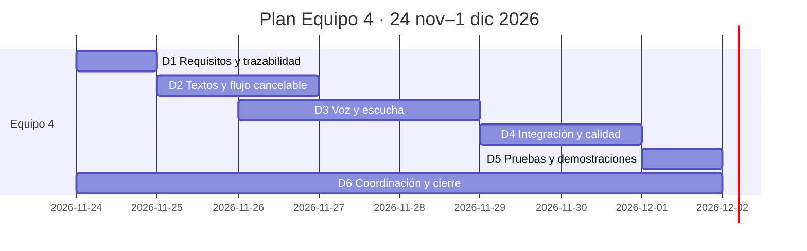

# Resumen ejecutivo

Yucu Protocol trabaja como prototipo para que personas artesanas registren lotes y compradores puedan consultar su procedencia. A partir de pruebas exploratorias con artesanas y productores, el Equipo 4 propone corregir el módulo de pantallas #182 para que el sello no parezca un cobro, toda acción importante pueda cancelarse y la voz pueda usarse sin confundir o bloquear a la persona. Los beneficiarios son las personas usuarias del prototipo, las artesanas y los compradores que prueban el flujo. El costo estimado es de **MXN $10,200** por 68 horas-persona y el cierre de la propuesta se plantea para el **1 de diciembre de 2026**. La estimación es un costo académico de oportunidad, no una cotización ni un compromiso de pago; el diseño inmediato previsto es de $0.

El alcance se limita a textos, explicación del sello, cancelación, controles de voz y componentes de accesibilidad en las pantallas definidas por #182. El entregable combina integración con pruebas positivas y negativas, revisión de privacidad y evidencia con datos inventados. Stellar interviene como contexto de procedencia y testnet, pero este módulo no modifica contratos, procesa fondos ni realiza atestaciones reales públicas.

# Problema y contexto

Las pruebas cualitativas documentadas en [Hito 1.2: análisis de fricción UX](../../ux-testing/HITO_1.2_AUDITORIA_FRICCION_UX.md) abarcaron siete personas en cuatro comunidades. Esta es evidencia exploratoria, no una medida representativa. En las observaciones se registró confusión al pensar que el sello era un trámite o cobro, temor a borrar o dañar el teléfono y dificultad para manejar el botón del micrófono. Una persona mantendría el botón presionado en lugar de tocarlo. Los hallazgos respaldan una necesidad real de confirmar antes de actuar, usar lenguaje sencillo y ofrecer más de una forma de controlar la grabación.

La [validación con compradores](../../ux-testing/HITO_1.3_VALIDACION_COMPRADORES.md) encontró dificultades con términos técnicos y obtuvo 55/100 de SUS en una prueba con tres estudiantes que simularon consumidores. No fueron compradores reales. Este dato sirve para priorizar claridad y volver a probar, no para afirmar calidad representativa ni satisfacción general. Las fuentes públicas presentan citas anónimas y hallazgos por rol, sin nombres, fotos, teléfonos ni identificadores. Cualquier original identificable se conserva fuera del repositorio conforme a [PRIVACIDAD.md](../../research/PRIVACIDAD.md).

El problema organizacional del módulo es: las personas pueden interpretar incorrectamente un elemento visual o temer una acción irreversible, lo que reduce la comprensión y confianza. La decisión está respaldada por observaciones del campo, una señal de usabilidad y criterios explícitos en la Edición #182.

# Objetivo SMART y alcance

- **S — Específico:** entregar en las pantallas del módulo #182 microcopy centralizado, explicación sencilla del sello, acciones cancelables, control de micrófono por toque y mantener-soltar, límite de 60 segundos y lectura accesible con fallback.
- **M — Medible:** antes del **1 de diciembre de 2026**, aprobar las pruebas descritas por #182: todas las pruebas positivas y negativas aplicables deben pasar; cancelar no debe enviar ni guardar; las pantallas artesanas deben tener regreso/cancelación; y la ausencia de voz española debe mostrar texto y aviso sin fallar.
- **A — Alcanzable:** reutilizar componentes, herramientas y arquitectura existentes, reservar 68 horas-persona y limitarse a pantallas y lógica de interfaz. No se requieren nuevas cuentas pagadas ni desarrollo de contratos.
- **R — Relevante:** responde a fricciones observadas de comprensión, seguridad percibida y accesibilidad de voz, y permite revisar si el diseño respeta la decisión de la persona usuaria antes de continuar.
- **T — Temporal:** integrar, probar y presentar la evidencia revisable a más tardar el **1 de diciembre de 2026**.

**Incluye:** explicación del sello sin llamarlo oficial o certificado; confirmación previa y botones Cancelar/Regresar; grabación por toque-toque y mantener-soltar con contador e indicador; límite de 60 segundos; lector en español mexicano con `Escuchar` y `Repetir`; texto visible y aviso si no hay voz española; pruebas, capturas con datos inventados y revisión de privacidad.

**No incluye:** pagos, wallets o manejo de fondos; contratos Soroban; registro real en Stellar mainnet; transcripción automática por IA como evidencia oficial; certificaciones, traducciones o validaciones ya realizadas con comunidades; despliegue productivo, auditoría ni garantía de ventas, ingresos o resultados comerciales. Cualquier ampliación requiere nueva estimación y aprobación.

# Solución y uso de Stellar

La solución agrega una interfaz comprensible alrededor de acciones que involucran procedencia y atestaciones: explica qué representa el sello, anuncia qué ocurrirá antes de guardar o enviar, permite cancelar y ofrece alternativas de voz y texto. La decisión final sigue siendo de la persona usuaria; el componente de IA no tiene firma ni certificado.

Stellar es relevante porque Yucu representa lotes y verificaciones en su arquitectura sobre testnet. Este módulo no altera contratos ni realiza transacciones. Separa la explicación de la interfaz de cualquier operación real en cadena: no se afirmará que una pantalla demuestra una atestación o pago real si solo usa datos simulados.

El estado general debe consultarse en la tabla [Implementation status / Qué es real y qué es simulado](../../../README.md#implementation-status): PWA y almacenamiento sin conexión son reales; los contratos están desplegados en testnet con pruebas y no están auditados; varias API, atestaciones de voz, catálogos y adaptadores son demostración, simulación o están pendientes.

- **Real al cierre:** únicamente código integrado que esté probado y verificado en la rama.
- **Demostración:** recorridos con datos inventados y etiquetas `source: 'simulated'` o `DemoBadge`.
- **Simulado:** respuestas, hashes, flujos de pago o verificaciones que el repositorio declara explícitamente como simulados.
- **Pendiente:** voz en español no disponible, transcripción externa, integración real con contratos y pruebas con personas reales si aún no pasan o no tienen aprobación.

# Plan de trabajo y cronograma

Fechas: **24 de noviembre al 1 de diciembre de 2026**. Cada entrega indica responsabilidad, producto y verificación.

| Entrega | Qué se entrega | Cómo se verifica | Fecha | Responsable |
|---|---|---|---|---|
| D1. Requisitos y trazabilidad | Lista de criterios de #182 vinculados a pantallas y pruebas. | Revisión cruzada contra la descripción de #182 y lista positiva/negativa. | 24 de noviembre de 2026 | Equipo 4 |
| D2. Textos y flujo cancelable | Microcopia centralizada, explicación del sello y estados cancelar/regresar. | Revisión de lenguaje claro y recorrido manual de pantallas. | 25 y 26 de noviembre de 2026 | Equipo 4 |
| D3. Voz y escucha | Gestos de micrófono, contador de 60 segundos, cancelar y componente `Escuchar`. | Pruebas positivas/negativas de gestos, límite y respaldo sin voz española. | 26–28 de noviembre de 2026 | Equipo 4 |
| D4. Integración y calidad | Cambios integrados en pantallas y correcciones. | `npm run lint`, `npm test`, `npm run build` y revisión de fallos. | 29 y 30 de noviembre de 2026 | Equipo 4 |
| D5. Pruebas y demostraciones | Capturas con datos inventados, matriz de criterios y pendientes. | Revisión de privacidad y trazabilidad entre captura, prueba y criterio. | 1 de diciembre de 2026 | Equipo 4 |
| D6. Coordinación y cierre | Seguimiento, decisiones, revisión del PR y resumen. | Tablero actualizado y verificación de `Resolves #215`. | 24 de noviembre–1 de diciembre de 2026 | Equipo 4 |

# Presupuesto y personal

Estimación de planeación: **68 horas-persona × MXN $150/h = MXN $10,200** de costo de oportunidad académica. La tarifa es un supuesto comparativo, no un pago acordado ni una fuente de ingresos. La organización no financia el trabajo y el diseño previsto es **MXN $0** mientras se usan herramientas existentes sin costo. Cualquier compra, servicio o remuneración requiere presupuesto aprobado antes de comprometerlo.

| Entregable | Responsable | Horas | Tarifa | Costo |
|---|---|---:|---:|---:|
| D1. Requisitos y trazabilidad | Equipo 4 | 8 | MXN $150/hora | MXN $1,200 |
| D2. Textos y flujo cancelable | Equipo 4 | 12 | MXN $150/hora | MXN $1,800 |
| D3. Voz y escucha | Equipo 4 | 16 | MXN $150/hora | MXN $2,400 |
| D4. Integración y calidad | Equipo 4 | 16 | MXN $150/hora | MXN $2,400 |
| D5. Pruebas y demostraciones | Equipo 4 | 8 | MXN $150/hora | MXN $1,200 |
| D6. Coordinación y cierre | Equipo 4 | 8 | MXN $150/hora | MXN $1,200 |
| **Costo de calidad Sprint 2 (incluido, no sumado otra vez)** | Equipo 4 | 16 | MXN $150/hora | MXN $2,400 |
| **Totales** | **Equipo 4** | **68** | | **MXN $10,200** |

La tabla incluye el costo de calidad dentro de las entregas: prevención (4 h), evaluación (8 h) y corrección interna (4 h), en total 16 h por MXN $2,400. El desglose queda dentro de las 68 horas y no se suma otra vez al total. El costo restante de desarrollo y coordinación es de 52 h por MXN $7,800.

La distribución del esfuerzo será equitativa entre los cuatro integrantes: **17 horas por integrante**, para completar las 68 horas-persona. Cada integrante hará al menos un commit y registrará el esfuerzo real cuando se confirme el tablero.

# Riesgos y viabilidad

**Decisión: Ir condicional.** El alcance está acotado, tiene pruebas verificables y no requiere financiación externa. Es viable solo si las cuatro personas disponibles confirman 17 horas cada una, el equipo conserva herramientas sin costo y las pruebas usan datos ficticios. Si el costo real supera el supuesto, se requiere nueva autorización.

Frente a un presupuesto de **MXN $10,200** y un financiamiento confirmado de $0, no se puede justificar un gasto monetario. El equipo solo acepta trabajo voluntario académico y un diseño previsto de $0. Si se necesita pagar trabajo, comprar herramientas o financiar campo real, la decisión pasa a **No-Go** hasta obtener presupuesto y responsables autorizados.

| Riesgo: si… entonces… | Probabilidad | Impacto | Respuesta | Responsable |
|---|---|---|---|---|
| Si los dispositivos no ofrecen voz `es-MX`, entonces el lector no puede depender del audio. | Media | Medio | Detectar voz disponible, mostrar texto legible y aviso, y ejecutar la prueba negativa. | Equipo 4 |
| Si los gestos del micrófono producen envíos accidentales, entonces se daña la confianza y se puede exponer una grabación. | Media | Alto | Conservar Cancelar visible, probar toque-toque y mantener-soltar y bloquear el envío al cancelar. | Equipo 4 |
| Si una pantalla incluida queda sin Cancelar/Regresar, entonces la persona puede sentirse atrapada o perder datos. | Media | Alto | Inventariar pantallas, recorrerlas y bloquear la entrega hasta corregir el flujo. | Equipo 4 |
| Si el equipo no dispone de 68 horas o aparece un costo de herramienta, entonces la fecha y el presupuesto dejarán de ser viables. | Media | Alto | Confirmar disponibilidad antes de empezar, reducir el alcance sin quitar salvaguardas o declarar No-Go. | Equipo 4 |
| Si una captura o documento contiene datos personales, entonces no debe publicarse en el repositorio. | Baja | Alto | Usar datos ficticios y revisar evidencia contra [PRIVACIDAD.md](../../research/PRIVACIDAD.md); retirar material no conforme. | Equipo 4 |

# Evidencia y siguientes pasos

**Evidencia revisable:**

- [Hito 1.2: análisis de fricción UX](../../ux-testing/HITO_1.2_AUDITORIA_FRICCION_UX.md): resumen de siete entrevistas exploratorias y hallazgos por fricción.
- [Hito 1.3: validación con compradores](../../ux-testing/HITO_1.3_VALIDACION_COMPRADORES.md): prueba limitada con tres participantes simulados y SUS de 55/100.
- [Edición #182](https://github.com/Open-Hub-Tec/yucu-protocol/issues/182): alcance, criterios de aceptación y exclusiones del módulo.
- [README, estado de implementación](../../../README.md#implementation-status): diferencia componentes reales, demostrativos, simulados y pendientes.
- Pruebas y capturas del PR: deberán contener datos inventados, aprobar la revisión de privacidad y mostrar el estado de cada criterio.
- [Carta de entendimiento #217](https://github.com/Open-Hub-Tec/yucu-protocol/issues/217): el estado de consulta, aprobación o firma debe confirmarse por el equipo. Esta propuesta no presume que esté firmada; no se publicarán firmas ni archivos identificables.

**Siguientes pasos con fecha:**

| Paso | Prueba de cierre | Fecha | Responsable |
|---|---|---|---|
| Confirmar disponibilidad de 68 h, alcance, integrantes y tablero. | Confirmación del equipo y decisión Go/No-Go registrada. | 24 de noviembre de 2026 | Equipo 4 |
| Validar microcopia y criterios con el equipo. | Lista de criterios aprobados y acordados en el tablero. | 25 de noviembre de 2026 | Equipo 4 |
| Completar revisión inicial de voz, cancelación y respaldo. | Pruebas positivas/negativas ejecutadas y pendientes listados. | 28 de noviembre de 2026 | Equipo 4 |
| Ejecutar revisión cruzada de pruebas, accesibilidad y privacidad. | Comentario sustantivo de revisión y correcciones enlazadas. | 30 de noviembre de 2026 | Equipo 4 |
| Presentar evidencia integrada y actualizar estado de la carta. | PR con `Resolves #215`, criterios verificados y pendientes explícitos. | 1 de diciembre de 2026 | Equipo 4 |

**Ética y datos personales.** Se aplica [PRIVACIDAD.md](../../research/PRIVACIDAD.md): no se publican nombres, voces, fotos, teléfonos ni identificadores de personas comunitarias. Las evidencias usan citas anónimas y datos ficticios. No se prometerán ventas, ingresos, certificaciones ni se afirmará que el sistema está en producción o auditado sin evidencia verificable.

**Trabajo en equipo.** Cada integrante debe hacer al menos un commit propio en el PR de esta propuesta y una persona distinta debe dejar comentarios sustantivos de revisión. La calidad se evalúa por redacción clara, trazabilidad, pruebas y cumplimiento de privacidad, no por declaraciones sin respaldo.

**Relación con el problema n.º 215.** Esta propuesta se vincula con el problema n.º 215 mediante la implementación, integración y verificación de los cambios descritos. El cierre deberá comprobar que los criterios de aceptación estén cumplidos y que el PR correspondiente incluya `Resolves #215`.
Resolves #215
