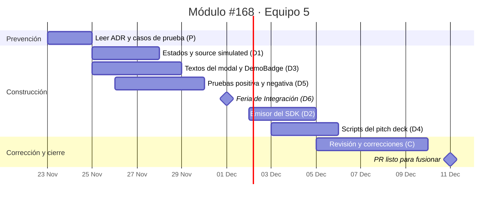

# Propuesta final · Equipo 5

**Módulo:** #168 · La IA sugiere, no certifica (alinear código y textos con la arquitectura v2)
**Organización mixteca:** Comité Comunitario de Cultura y Lengua de Santa María Cuquila
**Asignatura:** Gestión de Proyectos de Software (SCG-1009) · Unidad 4 · Sprint 4 · TecNM Campus Tlaxiaco
**eduScrum Master del Sprint 4:** @DaisyOrtiz2
**Integrantes:** @elisa1223 @DiegoLV117 @Yare-mon @DaisyOrtiz2
**Fecha:** 21 de noviembre de 2026

> Privacidad: este documento no incluye nombres, voces, fotos, teléfonos ni números de control de nadie de la comunidad. Seguimos [PRIVACIDAD.md](../../research/PRIVACIDAD.md). Los integrantes aparecen solo con su @usuario.

---

## Resumen ejecutivo

**Problema.** La app de Yucu todavía dice que la IA "certifica": hay resultados con estado `CERTIFIED`, un botón "Certificar calidad" y textos sobre "oráculos autónomos". Eso contradice la arquitectura v2 (ADR-005 y ADR-007), en la que la IA solo redacta y sugiere, y **una persona firma**. Para una organización como el Comité, que en el Sprint 1 pidió que **nada se publique sin validación de la comunidad**, una app que "certifica sola" es una promesa falsa y un riesgo para su confianza.

**Solución.** Cambiar el código y los textos para que ningún resultado de IA diga "certificado". Los resultados pasan a estados de sugerencia (`SUGGESTED`, `NEEDS_REVIEW`, `NOT_AVAILABLE`), llevan `source: 'simulated'` y se marcan en pantalla con `<DemoBadge />`. Los textos dirán, por ejemplo, "Sugerir calidad (la confirma una persona)".

**Beneficiarios.** Las personas productoras y el Comité, que conservan la decisión final sobre lo que se firma; las personas compradoras, que ya no leen certificaciones que nadie emitió; y el equipo de Yucu, que tendrá código coherente con su arquitectura.

**Costo y fecha.** **36 horas y $5,700 MXN** (36 h × $150 + $300 de gastos). Demostración en la **Feria de Integración del 1 de diciembre de 2026** y cierre del PR a más tardar el **11 de diciembre de 2026**. Son las mismas cifras de las secciones 5 y 6.

---

## Problema y contexto

### Lo que dice la organización (evidencia de campo)

En el Sprint 1 el equipo trabajó con el Comité Comunitario de Cultura y Lengua de Santa María Cuquila y firmó con él el *Acta de Criterios de Aceptación* (31 de agosto de 2026). De esa sesión salen tres acuerdos que este módulo respeta:

| Acuerdo del acta (Sprint 1) | Qué significa para el módulo #168 |
|---|---|
| "Mantener la revisión antes de publicar" (HU-03) y la historia HU-05 *Validar contenido* | La validación la hace una persona de la comunidad, no un sistema automático. |
| "Conservar la fuente y la fecha" (HU-02 y HU-04) | Todo resultado debe decir de dónde viene; si es simulado, debe decir `simulated`. |
| Dictamen "viable con ajustes" en validación comunitaria y procedencia del contenido | Una app que "certifica" sin persona rompe la condición con la que el Comité aceptó el proyecto. |

> «Ninguna palabra se publica sin la revisión del Comité.» — acuerdo registrado en el acta, sin nombre de quien lo dijo.

<!-- COMPLETAR: si en la sesión de lectura de la carta (#220) alguien del Comité comenta algo sobre la IA, agregar aquí la cita SIN nombre, solo con el rol y la fecha. -->

### Lo que encontramos en el código (observación directa)

Revisamos el repositorio en la rama `main` y contamos los lugares donde la app dice que la IA certifica:

| Archivo | Qué dice hoy |
|---|---|
| `src/core/agents/YucuAgentSwarm.ts` | "Micro-oráculos autónomos" que devuelven `status: 'CERTIFIED'` |
| `src/core/ai/RaizAIOracles.ts` | Puntajes fijos presentados como resultados reales |
| `src/core/sdk/RaizProtocolSDK.ts` | Emisor "AIQualityOracle + Certified Q-Grader" y "certificación de cero deforestación" |
| `src/components/ProtocolInfrastructureModal.tsx` | Botón "Certificar Calidad", "Oráculos Autónomos" y "Digest de Certificación" |
| `scripts/generate_pitch_deck.ts` y `_es.ts` | Diapositivas con `attestation_registry` y oráculos autónomos |

**Cifras:** 5 archivos de código y 2 archivos de pruebas (`agent_swarm_and_innovations.test.ts` y `ai_oracles_and_protocol.test.ts`) dependen del estado `CERTIFIED`.

### Por qué importa

Si una persona compradora lee "certificado por IA", cree que alguien respondió por la calidad. Nadie lo hizo. El riesgo cae sobre la productora y sobre el Comité, que pierden credibilidad si la promesa resulta falsa.

---

## Objetivo SMART y alcance

### Objetivo

**Para el 11 de diciembre de 2026**, el Equipo 5 abrirá y llevará a revisión un PR en `Open-Hub-Tec/yucu-protocol` con `Resolves #168`, en el que **0 resultados de IA** aparezcan como certificados (`grep -rn "CERTIFIED" src/` sin resultados de IA), **el 100 %** de los resultados de `YucuAgentSwarm` y `RaizAIOracles` lleven `source: 'simulated'`, haya **al menos 1 prueba positiva y 1 negativa nuevas**, y `npm run lint`, `npm test` y `npm run build` pasen. El trabajo costará **36 h y $5,700 MXN**, y se mostrará funcionando en la Feria de Integración del **1 de diciembre**.

| Letra | Cómo se cumple |
|---|---|
| **S** · Específico | Un módulo (#168), cinco archivos nombrados, un repositorio y un equipo responsable. |
| **M** · Medible | 0 "CERTIFIED" de IA, 100 % con `source: 'simulated'`, ≥ 2 pruebas nuevas, 3 comandos en verde, capturas antes y después. |
| **A** · Alcanzable | 36 h con una capacidad de 15 h por semana: 2.4 semanas entre el 23 de noviembre y el 11 de diciembre (sección 5). |
| **R** · Relevante | Cumple la arquitectura v2 y el acuerdo del Comité: la IA propone, la persona decide. |
| **T** · Temporal | Demo el 1 de diciembre y PR listo para fusionar el 11 de diciembre. |

### Objetivo: qué incluye

- Estados de sugerencia y `source: 'simulated'` en `YucuAgentSwarm.ts` y `RaizAIOracles.ts`.
- Emisor del SDK que nunca es un "oráculo de IA".
- Textos de la interfaz en español claro y `<DemoBadge />` en lo simulado.
- Scripts del *pitch deck* con Attest Protocol + índice Yucu.
- Pruebas actualizadas y nuevas (positiva y negativa).

### Objetivo: qué no incluye (fuera del alcance)

El módulo **no incluye** lo siguiente (queda fuera del alcance de #168):

- Borrar los oráculos o el modal.
- Conectar una IA real (eso es #154, la siguiente issue del equipo).
- Los textos "oficial", "mainnet" y de porcentajes (#108).
- El endpoint del servidor (#106).
- Cualquier cambio en los contratos de Soroban.

---

## Solución y uso de Stellar

### Qué se construye

```text
Antes:  IA ──► "CERTIFIED"            (nadie firma)
Ahora:  IA ──► "SUGGESTED" / "NEEDS_REVIEW" + source: 'simulated'
                      │
                      ▼
              La persona revisa y firma ──► atestación (Attest Protocol, ADR-005)
```

1. **Lógica:** un tipo de estado nuevo (`'SUGGESTED' | 'NEEDS_REVIEW' | 'NOT_AVAILABLE'`) en lugar de `'CERTIFIED'`.
2. **"Oráculos autónomos" → "Asistentes de IA (sugieren; una persona firma)"; "Digest de Certificación" → "Resumen de sugerencias (falta la firma de una persona)"..
3. **SDK:** la opinión de la IA se describe como opinión; el emisor de una atestación es siempre una persona.
4. **Pruebas:** cada resultado simulado sale con `source: 'simulated'`, y nunca con otra fuente.

### Por qué ayuda Stellar

Stellar no sirve para que la IA decida. Sirve para que **la firma de una persona quede registrada** de forma verificable y barata: la atestación queda en la red con quién firmó (su cuenta, no su nombre) y cuándo, y cualquiera puede comprobarla. Así se cumple el acuerdo del Comité de "conservar la fuente y la fecha". Este módulo deja el camino limpio para eso: la IA nunca aparece como emisora. Siguiendo la regla 4 de `AGENTS.md`, ningún archivo nuevo importa `@stellar/stellar-sdk` fuera de `src/core/chain/`.

### Qué es real, qué es demostración y qué está pendiente

Ver la tabla oficial **"Qué es real y qué es simulado"** en [README.md → Implementation status](../../../README.md#implementation-status). Para este módulo:

| Parte | Estado | Qué hace hoy |
|---|---|---|
| App web progresiva y almacenamiento sin conexión | ✅ Real | Se instala y guarda datos en el teléfono. |
| Contratos de Soroban | ✅ Real, solo en testnet | 4 contratos con pruebas; sin revisión de seguridad externa y sin mainnet. |
| Resultados de IA (`YucuAgentSwarm`, `RaizAIOracles`) | 🟡 Demostración | Valores simulados; después de este módulo dirán `source: 'simulated'` y mostrarán `<DemoBadge />`. |
| Puertos de cadena (`src/core/chain/`) | 🟡 Demostración | Implementación de prueba; las reales son issues abiertas. |
| IA real conectada | ⬜ Pendiente | Issue #154 (siguiente del equipo). |
| Atestación firmada por la persona en red | ⬜ Pendiente | Depende de Attest Protocol (ADR-005) y de los puertos reales. |

---

## Plan de trabajo y cronograma

Capacidad del equipo (la misma receta del Sprint 3): 4 personas × 5 h × 75 % = **15 h por semana**.

| ID | Entregable | Cómo se verifica | Fecha | Responsable |
|---|---|---|---|---|
| P | Prevención: leer `AGENTS.md`, ADR-003, ADR-005 y ADR-007; escribir primero los casos de prueba | Lista de casos en el PR y revisión de otra integrante | 24 de noviembre | @elisa1223 · @DaisyOrtiz2 |
| D1 | Estados de sugerencia y `source: 'simulated'` en `YucuAgentSwarm.ts` y `RaizAIOracles.ts` | `grep -rn "CERTIFIED" src/` sin resultados de IA | 27 de noviembre | @DiegoLV117 |
| D3 | Textos del modal en español claro y `<DemoBadge />` | Capturas antes y después en el PR; no aparecen "certificar", "certificación" ni "autónomo" | 28 de noviembre | @Yare-mon |
| D5 | Pruebas actualizadas, más una positiva y una negativa | `npm test` en verde en GitHub Actions | 29 de noviembre | @elisa1223 |
| D6 | Demostración en la Feria de Integración | Demo en vivo del modal con los textos nuevos | **1 de diciembre** | @DaisyOrtiz2 |
| D2 | Emisor del SDK sin oráculo de IA | Revisión del código; `npm run build` en verde | 4 de diciembre | @DiegoLV117 |
| D4 | Scripts del *pitch deck* con Attest Protocol + índice Yucu | Revisión de las diapositivas generadas | 5 de diciembre | @Yare-mon |
| C | Corrección: atender comentarios de la revisión y de Actions | Todos los comentarios resueltos | 9 de diciembre | @DiegoLV117 · @DaisyOrtiz2 |
| R | Reserva por riesgos (sección 7) | Se usa solo si un riesgo ocurre; se registra en el tablero | hasta el 11 de diciembre | Equipo (la administra @DaisyOrtiz2) |
| — | PR listo para fusionar con `Resolves #168` | lint, test y build en verde; revisión aprobada | **11 de diciembre** | @DaisyOrtiz2 |



---

## Presupuesto y personal

### Presupuesto · Paso 1: horas por entregable (estimación de tres puntos)

Construir = (Bien + Normal × 4 + Falla) ÷ 6, redondeado.

| Entregable | Bien | Normal | Falla | Construir |
|---|---:|---:|---:|---:|
| D1 · Estados y `source` | 4 | 6 | 10 | (4 + 24 + 10) ÷ 6 = **6 h** |
| D2 · Emisor del SDK | 2 | 3 | 6 | (2 + 12 + 6) ÷ 6 = **3 h** |
| D3 · Textos y `<DemoBadge />` | 3 | 5 | 8 | (3 + 20 + 8) ÷ 6 = **5 h** |
| D4 · Scripts del *pitch deck* | 1 | 2 | 4 | (1 + 8 + 4) ÷ 6 = **2 h** |
| D5 · Pruebas | 3 | 5 | 9 | (3 + 20 + 9) ÷ 6 = **5 h** |
| D6 · Demo en la feria | 2 | 3 | 5 | (2 + 12 + 5) ÷ 6 = **3 h** |
| **Construir** | | | | **24 h** |

### Presupuesto · Costo de la calidad (continuación del Sprint 2)

En el Sprint 2 el costo de la calidad del proyecto fue **$12,150** (30 h de prevención, 17 h de evaluación y 34 h de corrección, con j = 0.88). Aprendimos que corregir sale más caro que prevenir, así que este módulo planea **más prevención que corrección**, igual que HU-01 (la única con j = 1.33):

| Concepto | Horas | Costo |
|---|---:|---:|
| Prevención (P): leer ADR y escribir los casos de prueba primero | 4 h | $600 |
| Evaluación: pruebas de D5 (ya contadas en "construir") | (5 h) | ($750) |
| Corrección (C): atender la revisión y Actions | 3 h | $450 |
| **Costo de la calidad del módulo** | **12 h** | **$1,800** |
| **j = prevención ÷ corrección** | 4 ÷ 3 | **1.33 ≥ 1.00** |

### Presupuesto · Pasos 2 a 4: reserva, tiempo y costo

| Paso | Cálculo | Resultado |
|---|---|---|
| Horas | 24 construir + 4 prevenir + 3 corregir | **31 h** |
| Reserva (2 riesgos altos → 15 %) | 31 × 15 % = 4.65 ≈ 5 h | **36 h** |
| Tiempo | 36 h ÷ 15 h por semana | **2.4 semanas** (23 de noviembre – 11 de diciembre) |
| Trabajo | 36 h × $150 | $5,400 |
| Gastos | 1 visita al Comité para leer la carta (#220): 4 × $50 de pasaje + $100 de datos | $300 |
| **Costo total** | $5,400 + $300 | **$5,700 MXN** (≈ 308 USD a $18.50) |

### Presupuesto · Personal: horas por integrante

| Integrante | Rol | Entregables | Horas base | Reserva | Total |
|---|---|---|---:|---:|---:|
| @DiegoLV117 | Desarrollo de lógica | D1 (6) + D2 (3) + C (2) | 11 | 1 | **12 h** |
| @Yare-mon | Interfaz y textos | D3 (5) + D4 (2) | 7 | 1 | **8 h** |
| @elisa1223 | Pruebas y calidad | D5 (5) + P (2) | 7 | 1 | **8 h** |
| @DaisyOrtiz2 | eduScrum Master, demo y coordinación | D6 (3) + P (2) + C (1) | 6 | 2 | **8 h** |
| **Total** | | | **31 h** | **5 h** | **36 h** |

Tarifa de práctica: **$150 MXN por hora**, la misma de los Sprints 2 y 3 y para todo el equipo.

---

## Riesgos y viabilidad

### Riesgos del módulo

Escala de 1 a 5; nivel = probabilidad × impacto (alto ≥ 12).

| ID | Si… | Entonces… | P | I | Nivel | Respuesta | Dueño |
|---|---|---|---:|---:|---:|---|---|
| R1 | Si el equipo no puede explicar su código en la revisión | entonces el PR no se fusiona, aunque funcione | 3 | 5 | **15 · Alto** | Cada quien explica su parte en la reunión del 30 de noviembre antes de la feria; las pruebas se escriben primero (P) | @DaisyOrtiz2 |
| R2 | Si la carga de fin de semestre de otras materias nos quita horas | entonces no llegamos al 11 de diciembre | 4 | 3 | **12 · Alto** | Priorizar D1, D3 y D5 antes de la feria; D2 y D4 después. Se usa la reserva de 5 h | @DaisyOrtiz2 |
| R3 | Si otro equipo cambia los mismos archivos (#108, #106) | entonces aparecen conflictos al unir | 3 | 3 | 9 · Medio | Comentar en #108 y #106 que tocamos YucuAgentSwarm.ts, RaizAIOracles.ts y RaizProtocolSDK.ts; actualizar la rama cada dos días | @DiegoLV117 |
| R4 | Si cambiamos `CERTIFIED` y se rompen pruebas viejas | entonces Actions marca ❌ | 3 | 3 | 9 · Medio | Actualizar primero las dos pruebas existentes (D5) | @elisa1223 |
| R5 | Si un texto nuevo vuelve a sonar a "certificado" | entonces se repite el problema | 2 | 4 | 8 · Medio | Revisar los textos con la lista de palabras prohibidas de #168 | @Yare-mon |

Dos riesgos altos (R1 y R2) → **reserva del 15 %**, como en la receta del Sprint 3.

### Dictamen Go / No-Go según los riesgos

| Decisión | Dictamen | Fundamento |
|---|---|---|
| Construir el módulo #168 entre el 23 de noviembre y el 11 de diciembre | 🟡 **GO condicionado** | **Tiempo:** 36 h caben en 2.4 semanas a 15 h por semana, sin holgura extra; por eso es condicionado. **Dinero:** $5,700 MXN, casi todo en horas del equipo, cubiertos con recursos propios. **Calidad:** j = 1.33. |
| Contar con dinero de la Ola de Drips para pagar el módulo | ⛔ **NO-GO como fuente** | #168 vale 150 puntos en la Ola, pero el pago depende de que la issue se asigne a un solo equipo, se resuelva dentro de la semana de la Ola y la persona tenga KYC y wallet activa. Es un ingreso posible, no un financiamiento con el que se pueda planear. |
| Postular al Stellar Community Fund con este módulo | ⛔ **NO-GO** | El módulo corrige textos y estados; no agrega por sí solo un uso nuevo de Stellar. Se reevalúa cuando la atestación firmada esté en red. |

**Costo contra financiamiento realista:** $5,700 MXN (≈ 308 USD) frente a $0 de financiamiento externo asegurado. El proyecto es viable **porque no depende** de fondos externos.

**Condiciones para mantener el GO:**

1. El 1 de diciembre D1, D3 y D5 están listos para mostrarse. Si no, D4 pasa a la siguiente issue.
2. Las horas reales no superan 36 h. Si se pasan, @DaisyOrtiz2 replantea el alcance con el equipo.
3. La issue #168 sigue asignada al Equipo 5.

---

## Evidencia y siguientes pasos

### Evidencia que se puede revisar

| Evidencia | Dónde | Estado |
|---|---|---|
| Historias de usuario y Acta de Criterios con el Comité | Repositorio del Sprint 1 del equipo (GitHub Classroom, privado) | ✅ Firmada el 31 de agosto de 2026 |
| Plan de Calidad y costo de la calidad ($12,150, j = 0.88) | Repositorio del Sprint 2 | ✅ |
| Objetivo SMART, estimación y dictamen | https://github.com/SistemasTecTlaxiaco/gestion-de-proyectos-de-software-documento-smart-group-5 (privado, del curso) | ✅ |
| Matriz de riesgos | https://github.com/SistemasTecTlaxiaco/gestion-de-proyectos-de-software-matriz-de-riesgos-group-5 (privado, del curso) | ✅ |
| Tablero del equipo | Project de GitHub del Sprint 3 | ✅ |
| Observación del código del módulo | https://github.com/Open-Hub-Tec/yucu-protocol/issues/168 y sección 2 de este documento | ✅ |
| Prototipo | https://github.com/Open-Hub-Tec/yucu-protocol (tabla de estado en el [README](../../../README.md#implementation-status)) | 🟡 Demostración |
| Plan de informe a la organización | https://github.com/Open-Hub-Tec/yucu-protocol/issues/219 | ⬜ En preparación |
| Carta de entendimiento | https://github.com/Open-Hub-Tec/yucu-protocol/issues/220 | ⬜ Borrador en preparación; se leerá al Comité antes del 1 de diciembre |

### Ética y datos personales

- Se sigue [PRIVACIDAD.md](../../research/PRIVACIDAD.md): ningún dato de personas de la comunidad entra al repositorio.
- No prometemos ventas, ingresos ni certificaciones a nadie. El módulo hace justo lo contrario: quita promesas de certificación que la app no puede cumplir.
- Todo lo simulado se marca como simulado (`source: 'simulated'` y `<DemoBadge />`).

### Evidencia: siguientes pasos con fecha

| Fecha | Paso | Responsable |
|---|---|---|
| 22 de noviembre |  Comentario del equipo en #201 (hecho). Pedir la asignación de #168 | @DaisyOrtiz2 |
| 23 de noviembre | Crear la rama `fix/issue-168-ia-sugiere` | @DiegoLV117 |
| 24 de noviembre | Casos de prueba escritos (prevención) | @elisa1223 |
| 25 de noviembre | Plan de informe (#219) y borrador de carta (#220) en PR | @elisa1223 · @Yare-mon |
| 1 de diciembre | Demo en la Feria de Integración y carta final con minuta (#220) | @DaisyOrtiz2 |
| 11 de diciembre | PR de #168 listo para fusionar | Equipo |
| Siguiente periodo | Issue #154: conectar la IA real en el servidor | Equipo |
