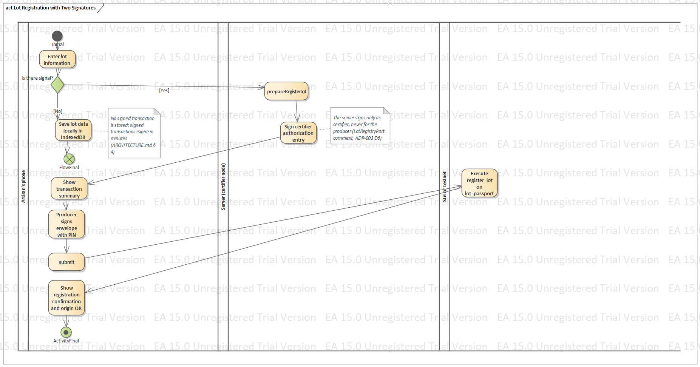

# Activity diagram: a lot is registered with two signatures

Diagrama de actividad UML que muestra cómo se registra un lote en `lot_passport`, que requiere dos firmas: la del nodo certificador y la del productor.
Si no hay señal, los datos se quedan en IndexedDB y no se guarda ninguna transacción firmada.
Con señal, el servidor prepara la transacción y firma solo como certificador; el productor firma el sobre en su teléfono con su PIN y la envía con `submit`.

## Elements

| Element | Type | Description |
|---|---|---|
| Artisan's phone | Partition (swimlane) | Teléfono de la artesana (productor) |
| Server (certifier node) | Partition (swimlane) | Servidor que actúa como nodo certificador |
| Stellar testnet | Partition (swimlane) | Red de prueba de Stellar |
| Initial | Initial node | Inicio del flujo |
| Enter lot information | Action | La artesana captura los datos del lote |
| Is there signal? | Decision node | Verifica si hay conectividad |
| Save lot data locally in IndexedDB | Action | Rama [No]: los datos se guardan en IndexedDB |
| FlowFinal | Flow final node | Termina la rama sin señal |
| prepareRegisterLot | Action (`LotRegistryPort` method) | Rama [Yes]: construye la transacción `register_lot` sin firmar |
| Sign certifier authorization entry | Action | El servidor firma solo la autorización del rol `certifier` |
| Show transaction summary | Action | El teléfono muestra el resumen de la transacción |
| Producer signs envelope with PIN | Action | El productor firma el sobre de la transacción con su PIN |
| submit | Action (`LotRegistryPort` method) | Envía el XDR firmado a la red |
| Execute register_lot on lot_passport | Action | La transacción se ejecuta en `lot_passport` |
| Show registration confirmation and origin QR | Action | El teléfono muestra la confirmación y el QR de origen |
| ActivityFinal | Activity final node | Fin del registro |

Notas en el diagrama:
- "No signed transaction is stored: signed transactions expire in minutes (ARCHITECTURE.md § 4)"
- "The server signs only as certifier, never for the producer (LotRegistryPort comment, ADR-003 D6)"

## Sources

- `src/core/chain/ports.ts`
- `docs/adr/ADR-003-NO-CUSTODIAL-Y-TRUSTLESS-WORK.md`
- `docs/ARCHITECTURE.md`
