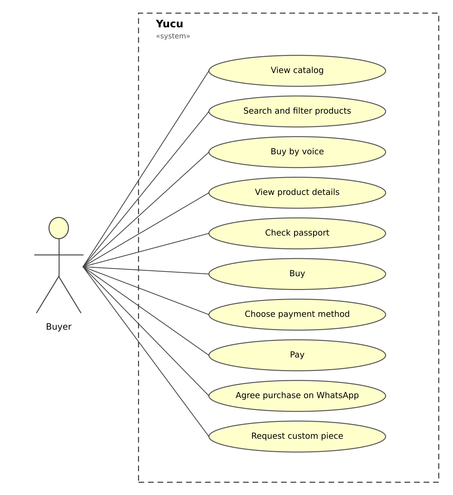

# Use case diagram: buyer

This diagram shows what a buyer does in Yucu: see the catalog, check a passport, buy and pay.
The actor is the Buyer, and each action the buyer can take in `BuyerShowcaseScreen.tsx` and `CartModal.tsx` is one use case inside the Yucu system boundary.
It only draws what the sources define; what is not defined is written as a note below the tables.

## Elements

| Element | Kind | Source |
| --- | --- | --- |
| `Buyer` | actor | `src/components/BuyerShowcaseScreen.tsx` |
| `Yucu` | system boundary | `src/components/BuyerShowcaseScreen.tsx`, `src/components/CartModal.tsx` |
| `View catalog` | use case | `src/components/BuyerShowcaseScreen.tsx` |
| `Search and filter products` | use case | `src/components/BuyerShowcaseScreen.tsx` |
| `Buy by voice` | use case | `src/components/BuyerShowcaseScreen.tsx` |
| `View product details` | use case | `src/components/BuyerShowcaseScreen.tsx` |
| `Check passport` | use case | `src/components/BuyerShowcaseScreen.tsx` |
| `Buy` | use case | `src/components/BuyerShowcaseScreen.tsx`, `src/components/CartModal.tsx` |
| `Choose payment method` | use case | `src/components/CartModal.tsx` |
| `Pay` | use case | `src/components/CartModal.tsx`, `docs/adr/ADR-003-NO-CUSTODIAL-Y-TRUSTLESS-WORK.md` |
| `Agree purchase on WhatsApp` | use case | `src/components/BuyerShowcaseScreen.tsx`, `src/components/CartModal.tsx` |
| `Request custom piece` | use case | `src/components/BuyerShowcaseScreen.tsx` |

## Use cases

| Use case | Short description | Real or simulated today |
| --- | --- | --- |
| View catalog | Product grid with price, artisan, location and stock (`BuyerShowcaseScreen`). | Real screen, simulated data: the products come from `INITIAL_PRODUCTS` in `src/data/mockData`, loaded in `App.tsx`. |
| Search and filter products | Search box, category pills and municipality pills filter the list in the browser. | Real. |
| Buy by voice | `Comprar por Voz` records speech; `handleVoiceCommand` matches keywords to filter, search or open the order. | Real in the browser (microphone and keyword matching). |
| View product details | Card image, title and `Detalles` open `ProductDetailModal`. | Real. |
| Check passport | `Ver Pasaporte Digital y Sello Criptográfico Stellar` calls `onViewPassport` and opens the `pasaporte_digital` screen. | Real navigation; the Stellar certification and seal shown there are a demonstration (`DemoBadge` in `DigitalPassportScreen.tsx`). |
| Buy | `Comprar Directo` calls `onAddToCart(item, true)`, which adds the item and opens `CartModal`. | Real. |
| Choose payment method | The buyer selects `spei`, `efectivo` or `escrow`. `spei` is preselected. | Selection is real; no payment is processed by it. |
| Pay | `Pagar y Confirmar Pedido` runs `handleExecutePayment` and shows the receipt. | Simulated: the folio, `stellarTxLedger` and `stellarTxHash` are generated with `Math.random()`, and `CartModal.tsx` makes no call to the network. |
| Agree purchase on WhatsApp | Link to `api.whatsapp.com` with a prefilled message, in the card and in the cart. | Real link; agreement and payment happen outside Yucu. |
| Request custom piece | `Solicitar pieza especial` calls `onDirectContact('Taller Comunitario', 'Pieza especial o mayoreo')`. | The button is real; what `onDirectContact` does is not defined in these sources. |

## Notes

- The `escrow` option is labeled `Custodia Escrow Stellar (Protegido)` in `CartModal.tsx`, but the component only stores that label in the receipt. ADR-003 (D2) says escrow purchases use Trustless Work; its section 3 lists the Trustless Work API as the real `EscrowPort` implementation and `SimulatedChain` as the demonstration one.
- ADR-003 (section 3) says an invented hash or ledger number is forbidden outside `SimulatedChain`, and that simulated results must show `<DemoBadge />`. `CartModal.tsx` generates `stellarTxHash` and `stellarTxLedger` itself and does not show `DemoBadge`, so the `Pay` use case does not match that rule yet.
- ADR-003 (D1) says Yucu never holds the buyer's keys or funds. This diagram does not draw wallet or signing steps because `CartModal.tsx` has none.

## Sources

- [`src/components/BuyerShowcaseScreen.tsx`](../../src/components/BuyerShowcaseScreen.tsx)
- [`src/components/CartModal.tsx`](../../src/components/CartModal.tsx)
- [`docs/adr/ADR-003-NO-CUSTODIAL-Y-TRUSTLESS-WORK.md`](../adr/ADR-003-NO-CUSTODIAL-Y-TRUSTLESS-WORK.md)
- Also read to classify real or simulated: `src/components/ProductDetailModal.tsx`, `src/components/DigitalPassportScreen.tsx`, `src/App.tsx`.
