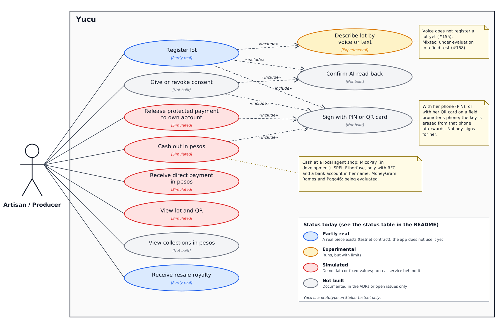

# Use case diagram: producer and artisan

This diagram shows what an artisan or smallholder producer of the Mixteca can do in Yucu, as the README, ADR-004 and ADR-007 describe it. The artisan is the only actor and every action sits inside the Yucu system boundary. A dashed `«include»` arrow means the action always goes through the step it points to.

Yucu is a prototype on Stellar testnet. The color and the label of each use case, and the last column of the table, say what is real today, using the same words as the status table in the README.

## Elements

| Element | Type | Description | Real or simulated today |
| --- | --- | --- | --- |
| Yucu | System boundary | The system that contains every use case in the diagram. | Prototype on Stellar testnet only. |
| Artisan / Producer | Actor | Artisan or smallholder producer of the Mixteca. She has her own Stellar account, but the interface only shows pesos: never a wallet, USDC, addresses or keys. | Not applicable. |
| Register lot | Use case | She registers a lot (a textile, a harvest) and signs it herself; the lot passport is kept in the `lot_passport` contract. Includes Describe lot by voice or text, Confirm AI read-back and Sign with PIN or QR card. | Partly real. The contract runs on testnet and requires the producer's signature, but the app does not call it yet; registered lots live only in app state. |
| Describe lot by voice or text | Use case | She speaks or types in the chat; AI drafts the lot and fills only the fields the schema allows. Anything unclear stays empty and is asked again. | Experimental. The server records real audio and calls Gemini when `GEMINI_API_KEY` is set. Voice does not register a lot yet; without the key some replies are invented. |
| Confirm AI read-back | Use case | The app reads the draft back with big Yes and No buttons, and she can fix a field by voice or by touch. | Not built. Documented in ADR-007. |
| Sign with PIN or QR card | Use case | She signs with her own phone (non-exportable key and PIN) or with her QR card on a field promoter's phone; the key is erased from that phone afterwards. Nobody signs for her. | Not built. The wallet and the QR card are open issues. |
| Give or revoke consent | Use case | Consent is an attestation issued by the artisan: she hears what she authorizes and can revoke it the same way. Includes Confirm AI read-back and Sign with PIN or QR card. | Not built. Documented in ADR-007; nothing of the voice engine is built. |
| Release protected payment to own account | Use case | In a protected purchase, a buyer abroad pays into a Trustless Work escrow. The group marks the order as shipped, the buyer approves, and she confirms with her PIN so the payment is released to her own account. Includes Sign with PIN or QR card. | Simulated. The escrow adapter keeps escrows in memory; the real escrow port is an open issue. |
| Cash out in pesos | Use case | She withdraws from her own account behind a single `PayoutPort`: cash at a local agent shop (MicoPay) or SPEI (Etherfuse, only with RFC and a bank account in her name). Includes Sign with PIN or QR card. | Simulated. The settlement orchestrator uses fixed exchange rates and locally generated SPEI folios; the real payout implementations are open issues. |
| Receive direct payment in pesos | Use case | A buyer in Mexico pays her directly in pesos, by SPEI or cash on delivery. The money does not go through Stellar; only the lot passport does. | Simulated. Buyer products are demo data and the settlement code uses fixed values. |
| View lot and QR | Use case | She sees her lot and its QR. Anyone who scans the QR on the piece can check its origin on Stellar without trusting Yucu. | Simulated. The `/api/v1/*` endpoints return fixed or random values; it is not a real verification service yet. |
| View collections in pesos | Use case | The "Mis cobros" screen: she sees in pesos what she has received. | Not built. Open issue. |
| Receive resale royalty | Use case | When a piece is resold through the `perpetual_royalties` contract, a royalty goes to her, and a community share (Tequio) goes to an account the community controls. | Partly real. The contract runs on testnet with tests and hardening is open; the app side still uses simulated adapters. |

## Sources

- [`README.md`](../../README.md)
- [`docs/adr/ADR-004-PAGOS-EN-PESOS-SIN-BILLETERA.md`](../adr/ADR-004-PAGOS-EN-PESOS-SIN-BILLETERA.md)
- [`docs/adr/ADR-007-MOTOR-DE-ATESTACIONES-POR-VOZ.md`](../adr/ADR-007-MOTOR-DE-ATESTACIONES-POR-VOZ.md)
