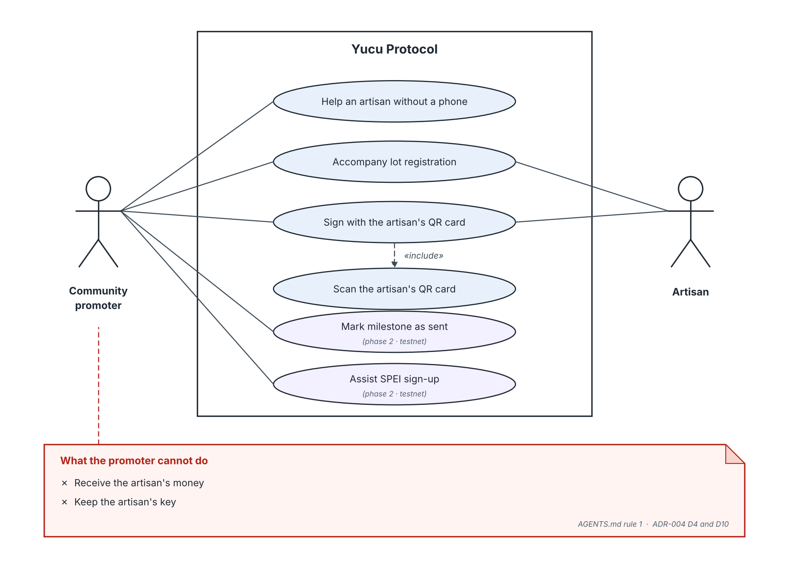

# Use case diagram: community promoter

This diagram shows what a community promoter does in Yucu Protocol, mostly to help artisans who do not have a phone. She scans the artisan's QR card on her own phone, the artisan types her PIN to sign, and the key is erased from the promoter's phone when signing ends.
The note at the bottom states what the promoter can not do: receive the artisan's money or keep her key (AGENTS.md rule 1). The two use cases tagged "phase 2 · testnet" are built only on testnet.

## Elements

| Element | Kind | Source |
|---|---|---|
| Community promoter | actor | ADR-002 section 3 (item 2); ADR-004 D4 |
| Artisan | actor (secondary) | ADR-004 D3 and D4 |
| Yucu Protocol | system boundary | AGENTS.md ("Qué es este proyecto") |
| Help an artisan without a phone | use case | ADR-002 section 3 (item 2); ADR-004 D4 |
| Accompany lot registration | use case | ADR-004 D3 and D10 |
| Sign with the artisan's QR card | use case | ADR-004 D4; AGENTS.md rule 1 |
| Scan the artisan's QR card | use case | ADR-002 section 3 (item 2); ADR-004 D4 |
| Mark milestone as sent | use case, tagged "(phase 2 · testnet)" | ADR-004 D8 |
| Assist SPEI sign-up | use case, tagged "(phase 2 · testnet)" | ADR-004 D9 |
| «include» | relationship: "Sign with the artisan's QR card" includes "Scan the artisan's QR card" | ADR-004 D4 |
| What the promoter cannot do | note | AGENTS.md rule 1; ADR-004 D4 and D10 |
| Receive the artisan's money | item of the note, marked with ✗ | AGENTS.md rule 1; ADR-004 D10 |
| Keep the artisan's key | item of the note, marked with ✗ | AGENTS.md rule 1; ADR-004 D4 |

## Notes

- **Who signs.** The artisan signs, not the promoter. She types her PIN (6 digits when the key is on a QR card) on the promoter's phone, and the key is erased from that phone when she finishes. It is never stored on another person's phone (ADR-004 D4). The promoter is associated with the signing use case only because she operates the phone, not because she signs.
- **"Accompany" and not "register".** ADR-004 D3 says the artisan and the certifier sign the lot registration, and the group can accompany her but does not sign for her. The certifier is not drawn because the sources do not describe a promoter task with him.
- **QR card key.** The channel matrix in ADR-002 lists a "delegated coop key" for the QR card. ADR-004 D4 later puts the artisan's own key in her card, and AGENTS.md rule 1 follows ADR-004. The diagram follows ADR-004.
- **Phase 2 use cases.** "Mark milestone as sent" comes from the escrow roles table in ADR-004 D8, where "the group or the promoter" marks the milestone and does not touch the money. "Assist SPEI sign-up" comes from ADR-004 D9: it is optional, only for artisans with an RFC and a bank account in their name, the artisan does the selfie herself, and both are built against a sandbox or testnet.
- **Not drawn.** ADR-004 D10 gives the community seal on royalties to the group. The sources do not say that the promoter does it, so it is not a use case here.

## Sources

- [ADR-004](../adr/ADR-004-PAGOS-EN-PESOS-SIN-BILLETERA.md)
- [ADR-002](../adr/ADR-002-OFFLINE-FIRST-PWA-AND-RURAL-IDENTITY.md)
- [`AGENTS.md`](../../AGENTS.md)
