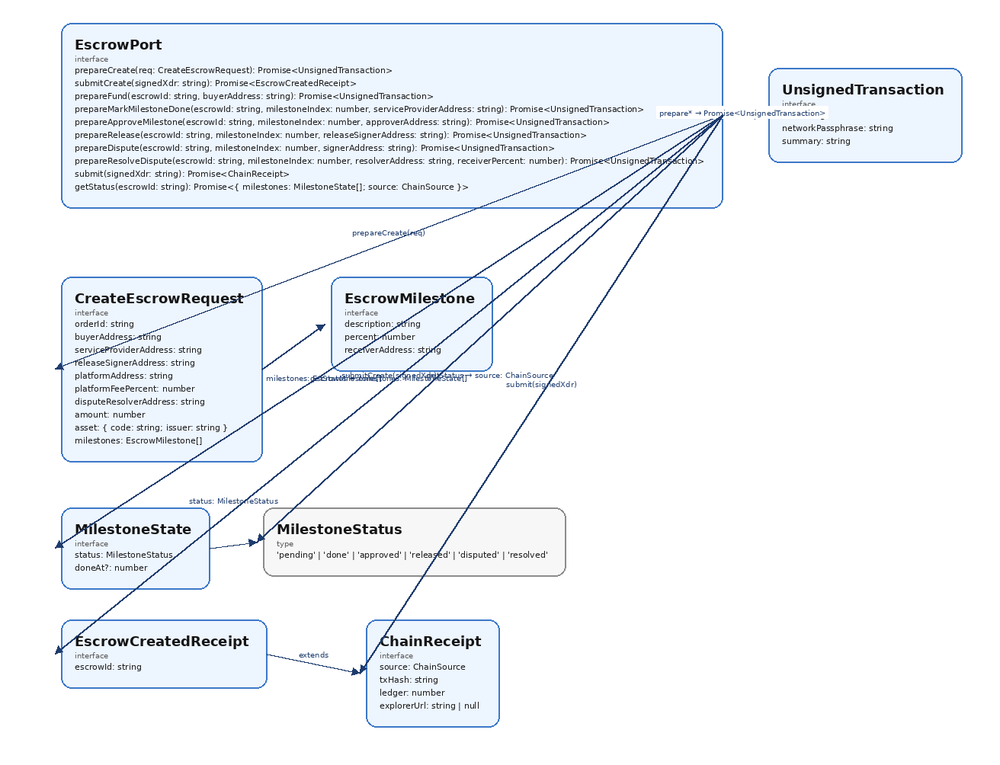

# Diagrama de clases del escrow

Diagrama de clases del puerto de Trustless Work y sus datos, tomado de [`src/core/chain/ports.ts`](../../src/core/chain/ports.ts). Muestra `EscrowPort`, los tipos de datos del escrow (`CreateEscrowRequest`, `EscrowMilestone`, `MilestoneState`, `MilestoneStatus`, `EscrowCreatedReceipt`) y los tipos que aparecen en su firma (`ChainReceipt`, `ChainSource`, `UnsignedTransaction`), con sus asociaciones.

## Tabla de elementos

Participantes, clases, métodos y estados del diagrama, exactamente como aparecen en él:

| Elemento | Miembros (exactamente como en el diagrama) |
|---|---|
| EscrowPort | interface: `prepareCreate(req: CreateEscrowRequest): Promise<UnsignedTransaction>`; `submitCreate(signedXdr: string): Promise<EscrowCreatedReceipt>`; `prepareFund(escrowId: string, buyerAddress: string): Promise<UnsignedTransaction>`; `prepareMarkMilestoneDone(escrowId: string, milestoneIndex: number, serviceProviderAddress: string): Promise<UnsignedTransaction>`; `prepareApproveMilestone(escrowId: string, milestoneIndex: number, approverAddress: string): Promise<UnsignedTransaction>`; `prepareRelease(escrowId: string, milestoneIndex: number, releaseSignerAddress: string): Promise<UnsignedTransaction>`; `prepareDispute(escrowId: string, milestoneIndex: number, signerAddress: string): Promise<UnsignedTransaction>`; `prepareResolveDispute(escrowId: string, milestoneIndex: number, resolverAddress: string, receiverPercent: number): Promise<UnsignedTransaction>`; `submit(signedXdr: string): Promise<ChainReceipt>`; `getStatus(escrowId: string): Promise<{ milestones: MilestoneState[]; source: ChainSource }>` |
| CreateEscrowRequest | interface: `orderId: string`; `buyerAddress: string`; `serviceProviderAddress: string`; `releaseSignerAddress: string`; `platformAddress: string`; `platformFeePercent: number`; `disputeResolverAddress: string`; `amount: number`; `asset: { code: string; issuer: string }`; `milestones: EscrowMilestone[]` |
| EscrowMilestone | interface: `description: string`; `percent: number`; `receiverAddress: string` |
| MilestoneState | interface: `status: MilestoneStatus`; `doneAt?: number` |
| MilestoneStatus | tipo (estados): `'pending' \| 'done' \| 'approved' \| 'released' \| 'disputed' \| 'resolved'` |
| EscrowCreatedReceipt | interface (extiende `ChainReceipt`): `escrowId: string` |
| ChainReceipt | interface: `source: ChainSource`; `txHash: string`; `ledger: number`; `explorerUrl: string \| null` |
| ChainSource | tipo: `'testnet' \| 'simulated'` |
| UnsignedTransaction | interface: `xdr: string`; `networkPassphrase: string`; `summary: string` |

## Relaciones entre elementos

Etiquetas de las flechas del diagrama:

- `prepareCreate(req)` — `EscrowPort` → `CreateEscrowRequest`
- `prepare* → Promise<UnsignedTransaction>` — `EscrowPort` → `UnsignedTransaction`
- `submitCreate(signedXdr)` — `EscrowPort` → `EscrowCreatedReceipt`
- `submit(signedXdr)` — `EscrowPort` → `ChainReceipt`
- `getStatus → milestones: MilestoneState[]` — `EscrowPort` → `MilestoneState`
- `getStatus → source: ChainSource` — `EscrowPort` → `ChainSource`
- `milestones: EscrowMilestone[]` — `CreateEscrowRequest` → `EscrowMilestone`
- `status: MilestoneStatus` — `MilestoneState` → `MilestoneStatus`
- `extends` — `EscrowCreatedReceipt` → `ChainReceipt`

## Fuentes

- [`src/core/chain/ports.ts`](../../src/core/chain/ports.ts) — declaración de `EscrowPort`, `CreateEscrowRequest`, `EscrowMilestone`, `MilestoneState`, `MilestoneStatus`, `EscrowCreatedReceipt`, `ChainReceipt`, `ChainSource` y `UnsignedTransaction`.
