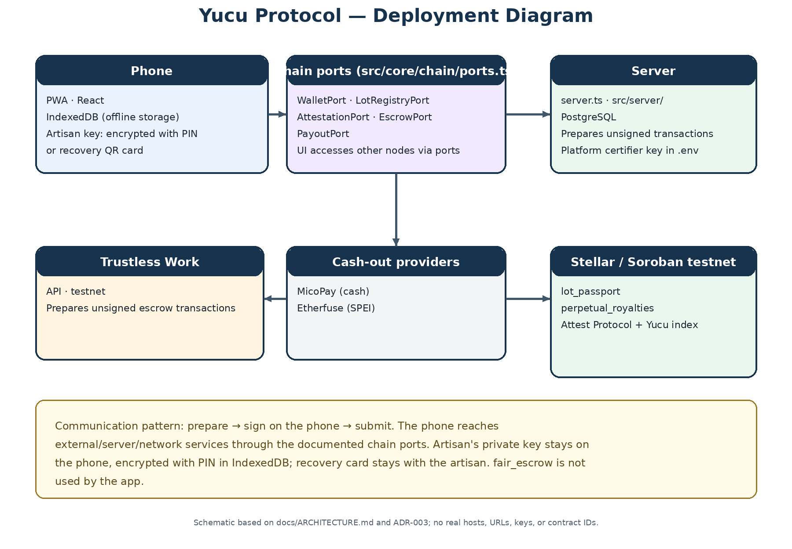

# Yucu Protocol Deployment Diagram

This diagram summarizes the documented deployment nodes of Yucu Protocol and the communication path through the chain ports.
The artisan's private key remains on the phone, encrypted with a PIN; the recovery card remains with the artisan.
The diagram is schematic and avoids real hosts, URLs, keys, and contract IDs.

## Elements

| Element | Type |
|---|---|
| Phone | Node |
| PWA | Component |
| React | Component |
| IndexedDB | Component |
| Chain ports (src/core/chain/ports.ts) | Interface boundary |
| WalletPort | Port |
| LotRegistryPort | Port |
| AttestationPort | Port |
| EscrowPort | Port |
| PayoutPort | Port |
| Server | Node |
| server.ts | Artifact |
| src/server/ | Component |
| PostgreSQL | Database |
| Trustless Work | Node |
| API | Component |
| testnet | Environment |
| Cash-out providers | Node |
| MicoPay | Provider |
| Etherfuse | Provider |
| Stellar / Soroban testnet | Node |
| lot_passport | Artifact |
| perpetual_royalties | Artifact |
| Attest Protocol + Yucu index | Component |
| Artisan key encrypted with PIN on phone / recovery QR card | Note |
| fair_escrow not used by app | Note |

## Sources

- `docs/ARCHITECTURE.md`
- `docs/adr/ADR-003-NO-CUSTODIAL-Y-TRUSTLESS-WORK.md`
- `src/core/chain/ports.ts`
