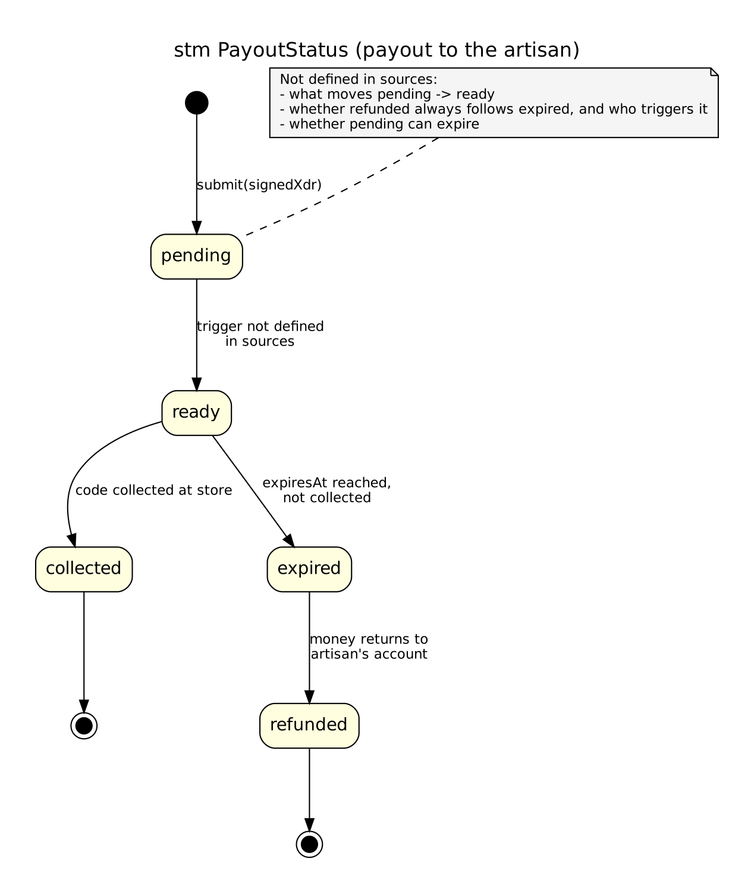

# State diagram: payout to the artisan

This diagram shows the life of a cash payout (`PayoutStatus`) after the artisan sends her signed cashout with `PayoutPort.submit`.
The payout ends either `collected` at the store, or `expired` when nobody uses the code before `expiresAt`, after which the money goes back to her account (`refunded`).
Where the sources do not define what causes a transition, the diagram says so in a note instead of guessing.

## Elements

| Element | Type | Description (from the sources) |
|---|---|---|
| `pending` | State | Value of `PayoutStatus`. Initial status after `submit(signedXdr)`. |
| `ready` | State | Value of `PayoutStatus`. The cashout code/QR can be collected at the store (`agentCode`). |
| `collected` | State | Value of `PayoutStatus`. The code was collected at the store. |
| `expired` | State | Value of `PayoutStatus`. `expiresAt` passed and nobody collected the code (15 minutes or less with `walletKind: 'card'`). |
| `refunded` | State | Value of `PayoutStatus`. The money went back to the artisan's account. |
| `submit(signedXdr)` | Transition trigger | `PayoutPort` method that sends the signed cashout and returns the code/QR and its expiry. |
| `code collected at store` | Transition trigger | `ready` → `collected`. |
| `expiresAt reached, not collected` | Transition trigger | `ready` → `expired`. |
| `money returns to artisan's account` | Transition trigger | `expired` → `refunded`. |
| `trigger not defined in sources` | Transition trigger | `pending` → `ready`. Neither source says what causes it. |
| Note: undefined in sources | Note | Lists what the sources do not define (see below). |

## Not defined in the sources

- What moves a payout from `pending` to `ready`. `submit` already returns the code, and the sources do not say whether the provider has to confirm it first.
- Whether `refunded` always comes after `expired`, and whether the return is automatic or who triggers it.
- Whether `pending` can expire or be refunded directly.
- ADR-004 does not use the names `pending`, `ready`, `collected`, `expired` or `refunded`. They come only from `ports.ts`.

## Sources

- [`src/core/chain/ports.ts`](../../src/core/chain/ports.ts): `PayoutStatus`, `PayoutState`, `CashoutRequest`, `CashoutReceipt`, `PayoutPort` (`submit`, `getStatus`).
- [`docs/adr/ADR-004-PAGOS-EN-PESOS-SIN-BILLETERA.md`](../adr/ADR-004-PAGOS-EN-PESOS-SIN-BILLETERA.md): Phase 1 cash withdrawal with MicoPay (the QR is valid for 15 minutes).
