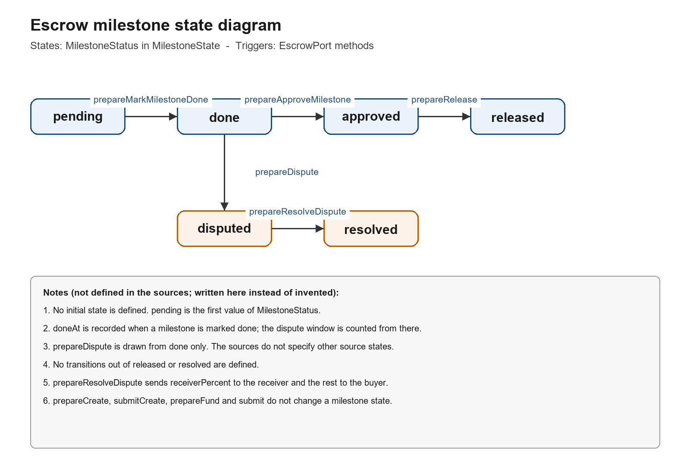

# State diagram: escrow milestone

This diagram shows the six states of an escrow milestone, taken exactly from `MilestoneStatus` in `src/core/chain/ports.ts`. Each labeled arrow is the `EscrowPort` method that triggers that transition. `MilestoneState` carries the current `status` and the optional `doneAt` timestamp; ADR-001 only provides the escrow context, so no other behavior is added.

## Elements

| Element | Kind | Source |
|---|---|---|
| `pending` | state (`MilestoneStatus`) | `src/core/chain/ports.ts` |
| `done` | state (`MilestoneStatus`) | `src/core/chain/ports.ts` |
| `approved` | state (`MilestoneStatus`) | `src/core/chain/ports.ts` |
| `released` | state (`MilestoneStatus`) | `src/core/chain/ports.ts` |
| `disputed` | state (`MilestoneStatus`) | `src/core/chain/ports.ts` |
| `resolved` | state (`MilestoneStatus`) | `src/core/chain/ports.ts` |
| `MilestoneStatus` | type | `src/core/chain/ports.ts` |
| `MilestoneState` | type | `src/core/chain/ports.ts` |
| `doneAt` | field of `MilestoneState` | `src/core/chain/ports.ts` |
| `EscrowPort` | interface | `src/core/chain/ports.ts` |
| `prepareMarkMilestoneDone` | transition label (method) | `src/core/chain/ports.ts` |
| `prepareApproveMilestone` | transition label (method) | `src/core/chain/ports.ts` |
| `prepareRelease` | transition label (method) | `src/core/chain/ports.ts` |
| `prepareDispute` | transition label (method) | `src/core/chain/ports.ts` |
| `prepareResolveDispute` | transition label (method) | `src/core/chain/ports.ts` |
| `receiverPercent` | parameter of `prepareResolveDispute` | `src/core/chain/ports.ts` |
| `prepareCreate` | note (method) | `src/core/chain/ports.ts` |
| `submitCreate` | note (method) | `src/core/chain/ports.ts` |
| `prepareFund` | note (method) | `src/core/chain/ports.ts` |
| `submit` | note (method) | `src/core/chain/ports.ts` |

## Notes

- No initial state is defined in the sources. `pending` is the first value of `MilestoneStatus`.
- `doneAt` is recorded when a milestone is marked done; the dispute window is counted from there.
- `prepareDispute` is drawn from `done` only. The sources do not specify other source states.
- No transitions out of `released` or `resolved` are defined.
- `prepareResolveDispute` sends `receiverPercent` to the receiver and the rest to the buyer.
- `prepareCreate`, `submitCreate`, `prepareFund` and `submit` do not change a milestone state.

## Sources

- [`src/core/chain/ports.ts`](../../src/core/chain/ports.ts)
- [`docs/adr/ADR-001-TRUSTLESS-WORK-ESCROW.md`](../adr/ADR-001-TRUSTLESS-WORK-ESCROW.md)
