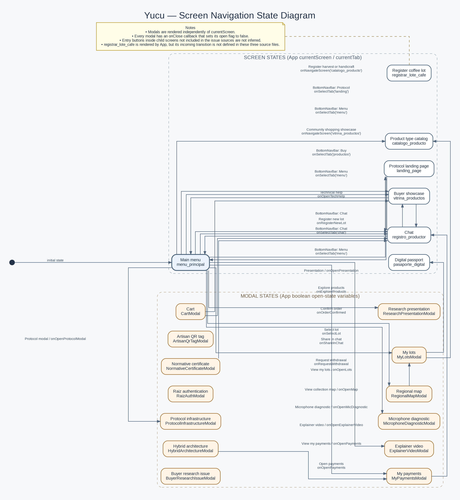

# Screen Navigation State Diagram

This diagram documents the screen states and modal states rendered by `App`, and the navigation actions exposed by `MainMenuScreen` and `BottomNavBar`.
Transitions are included only where the supplied source code defines the corresponding callback or state change.
Modal states are shown as overlays because `App` renders them separately from the main screen routing.

## Elements

| Element type | Element name | Description |
|---|---|---|
| Participant | `App` | Owns the current screen, navigation tab, and modal visibility state. |
| Participant | `MainMenuScreen` | Displays the main menu actions and invokes navigation or modal callbacks. |
| Participant | `BottomNavBar` | Displays the four navigation tabs and invokes `onSelectTab`. |
| State | `menu_principal` | Main menu screen; initial value of `currentScreen`. |
| State | `catalogo_producto` | Product type catalog screen. |
| State | `registrar_lote_cafe` | Coffee lot registration screen. |
| State | `pasaporte_digital` | Digital passport screen. |
| State | `registro_productor` | Chat screen. |
| State | `vitrina_productos` | Buyer showcase screen. |
| State | `landing_page` | Protocol landing page screen. |
| State | `MyLotsModal` | Modal controlled by `isLotsModalOpen`. |
| State | `MyPaymentsModal` | Modal controlled by `isPaymentsModalOpen`. |
| State | `NormativeCertificateModal` | Modal controlled by `isDictamenModalOpen`. |
| State | `ArtisanQrTagModal` | Modal controlled by `isQrTagModalOpen`. |
| State | `CartModal` | Modal controlled by `isCartModalOpen`. |
| State | `RegionalMapModal` | Modal controlled by `isMapModalOpen`. |
| State | `MicrophoneDiagnosticModal` | Modal controlled by `isMicDiagnosticModalOpen`. |
| State | `ExplainerVideoModal` | Modal controlled by `isExplainerVideoOpen`. |
| State | `ResearchPresentationModal` | Modal controlled by `isPresentationModalOpen`. |
| State | `RaizAuthModal` | Modal controlled by `isAuthModalOpen`. |
| State | `HybridArchitectureModal` | Modal controlled by `isArchitectureModalOpen`. |
| State | `ProtocolInfrastructureModal` | Modal controlled by `isProtocolModalOpen`. |
| State | `BuyerResearchIssueModal` | Modal controlled by `isBuyerIssueModalOpen`. |
| Method | `handleTabChange` | Maps `menu`, `chat`, `productos`, and `landing` to their corresponding screen states. |
| Method | `handleNavigateScreen` | Updates `currentScreen` and synchronizes `currentTab`. |
| Method | `onSelectTab` | Callback used by `BottomNavBar` when a navigation tab is pressed. |
| Method | `onNavigateScreen` | Callback used by `MainMenuScreen` to navigate to a screen. |
| Method | `onOpenLots` | Opens `MyLotsModal`. |
| Method | `onOpenPayments` | Opens `MyPaymentsModal`. |
| Method | `onOpenMap` | Opens `RegionalMapModal`. |
| Method | `onOpenMicDiagnostic` | Opens `MicrophoneDiagnosticModal`. |
| Method | `onOpenExplainerVideo` | Opens `ExplainerVideoModal`. |
| Method | `onOpenProtocolModal` | Opens `ProtocolInfrastructureModal`. |
| Method | `onOpenPresentation` | Opens `ResearchPresentationModal`. |
| Method | `onOpenTechHelp` | Sets the active tab to `chat` and the screen to `registro_productor`. |
| Note | Modal closing behavior | Each modal receives an `onClose` callback that sets its corresponding open-state variable to `false`; no separate destination screen is defined. |
| Note | `MyLotsModal` selection | Selecting a lot sets `currentTab` to `productos` and `currentScreen` to `pasaporte_digital`. |
| Note | `MyPaymentsModal` withdrawal | Requesting a withdrawal sets `currentTab` to `chat` and `currentScreen` to `registro_productor`. |
| Note | `CartModal` order confirmation | Confirmation sets `currentTab` to `chat` and `currentScreen` to `registro_productor`. |
| Note | Unspecified modal triggers | The source files listed for this issue do not define every internal button of each modal; those internal transitions are not inferred here. |

## Navigation transitions represented

- `BottomNavBar` → `menu`: `onSelectTab('menu')` → `menu_principal`.
- `BottomNavBar` → `chat`: `onSelectTab('chat')` → `registro_productor`.
- `BottomNavBar` → `productos`: `onSelectTab('productos')` → `vitrina_productos`.
- `BottomNavBar` → `landing`: `onSelectTab('landing')` → `landing_page`.
- `MainMenuScreen` option 1: `onNavigateScreen('catalogo_producto')` → `catalogo_producto`.
- `MainMenuScreen` option 2: `onOpenLots` → `MyLotsModal`.
- `MainMenuScreen` option 3: `onOpenPayments` → `MyPaymentsModal`.
- `MainMenuScreen` option 4: `onOpenTechHelp` → `registro_productor`.
- Main menu map action: `onOpenMap` → `RegionalMapModal`.
- Main menu diagnostic action: `onOpenMicDiagnostic` → `MicrophoneDiagnosticModal`.
- Main menu explainer action: `onOpenExplainerVideo` → `ExplainerVideoModal`.
- Main menu protocol action: `onOpenProtocolModal` → `ProtocolInfrastructureModal`.
- Main menu presentation action: `onOpenPresentation` → `ResearchPresentationModal`.
- Voice menu option 1 navigates to `catalogo_producto`; option 2 opens `MyLotsModal`; option 3 opens `MyPaymentsModal`; option 4 navigates to `registro_productor`; option 5 navigates to `vitrina_productos`.

## Sources

- `src/components/MainMenuScreen.tsx`
- `src/components/BottomNavBar.tsx`
- `src/App.tsx`
