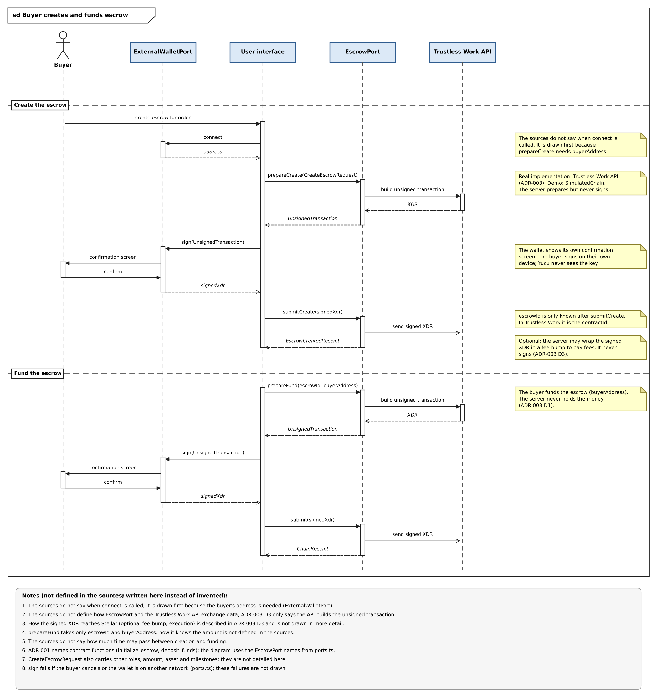

# Sequence diagram: buyer creates and funds an escrow

This diagram shows how a buyer creates an escrow for an order with Trustless Work and then funds it. Both steps follow the pattern prepare, sign, submit: the user interface asks `EscrowPort` to prepare an unsigned transaction, the buyer signs it in their own wallet (`ExternalWalletPort`), and `EscrowPort` sends it. The buyer signs on their own device and the server never signs or holds the money. `escrowId` is only known after `submitCreate`.

## Elements

| Element | Kind | Source |
|---|---|---|
| `Buyer creates and funds escrow` | interaction (frame `sd`) | this diagram |
| `Create the escrow` | section label | this diagram |
| `Fund the escrow` | section label | this diagram |
| `Buyer` | participant (actor) | `docs/adr/ADR-001-TRUSTLESS-WORK-ESCROW.md`, `src/core/chain/ports.ts` (`buyerAddress`) |
| `ExternalWalletPort` | participant (interface) | `src/core/chain/ports.ts`, `docs/adr/ADR-003-NO-CUSTODIAL-Y-TRUSTLESS-WORK.md` |
| `User interface` | participant | `docs/adr/ADR-003-NO-CUSTODIAL-Y-TRUSTLESS-WORK.md` (section 3) |
| `EscrowPort` | participant (interface) | `src/core/chain/ports.ts` |
| `Trustless Work API` | participant (external API) | `docs/adr/ADR-003-NO-CUSTODIAL-Y-TRUSTLESS-WORK.md` (D2, D3) |
| `create escrow for order` | message (user action) | this diagram |
| `connect` | message (method of `ExternalWalletPort`) | `src/core/chain/ports.ts` |
| `address` | return of `connect` | `src/core/chain/ports.ts` |
| `prepareCreate` | message (method of `EscrowPort`) | `src/core/chain/ports.ts` |
| `CreateEscrowRequest` | type (parameter of `prepareCreate`) | `src/core/chain/ports.ts` |
| `build unsigned transaction` | message | `docs/adr/ADR-003-NO-CUSTODIAL-Y-TRUSTLESS-WORK.md` (D3) |
| `XDR` | return | `docs/adr/ADR-003-NO-CUSTODIAL-Y-TRUSTLESS-WORK.md` (D3) |
| `UnsignedTransaction` | return type (and parameter of `sign`) | `src/core/chain/ports.ts` |
| `sign` | message (method of `ExternalWalletPort`) | `src/core/chain/ports.ts` |
| `confirmation screen` | message | `src/core/chain/ports.ts` (comment on `ExternalWalletPort`) |
| `confirm` | message (user action) | this diagram |
| `signedXdr` | return of `sign` and parameter of `submitCreate` and `submit` | `src/core/chain/ports.ts` |
| `submitCreate` | message (method of `EscrowPort`) | `src/core/chain/ports.ts` |
| `send signed XDR` | message | `docs/adr/ADR-003-NO-CUSTODIAL-Y-TRUSTLESS-WORK.md` (D3) |
| `EscrowCreatedReceipt` | return type | `src/core/chain/ports.ts` |
| `escrowId` | parameter of `prepareFund` and field of `EscrowCreatedReceipt` | `src/core/chain/ports.ts` |
| `prepareFund` | message (method of `EscrowPort`) | `src/core/chain/ports.ts` |
| `buyerAddress` | parameter of `prepareFund` and field of `CreateEscrowRequest` | `src/core/chain/ports.ts` |
| `submit` | message (method of `EscrowPort`) | `src/core/chain/ports.ts` |
| `ChainReceipt` | return type | `src/core/chain/ports.ts` |
| `SimulatedChain` | demo implementation (in a note) | `docs/adr/ADR-003-NO-CUSTODIAL-Y-TRUSTLESS-WORK.md` (section 3) |
| `contractId` | Trustless Work name for the escrow ID (in a note) | `docs/adr/ADR-003-NO-CUSTODIAL-Y-TRUSTLESS-WORK.md` (section 3) |
| `fee-bump` | term (in a note) | `docs/adr/ADR-003-NO-CUSTODIAL-Y-TRUSTLESS-WORK.md` (D3) |
| `Stellar` | network (in a note) | `docs/adr/ADR-003-NO-CUSTODIAL-Y-TRUSTLESS-WORK.md` (D3) |
| `initialize_escrow` | contract function (in a note) | `docs/adr/ADR-001-TRUSTLESS-WORK-ESCROW.md` |
| `deposit_funds` | contract function (in a note) | `docs/adr/ADR-001-TRUSTLESS-WORK-ESCROW.md` |
| `amount` | field of `CreateEscrowRequest` (in a note) | `src/core/chain/ports.ts` |
| `asset` | field of `CreateEscrowRequest` (in a note) | `src/core/chain/ports.ts` |
| `milestones` | field of `CreateEscrowRequest` (in a note) | `src/core/chain/ports.ts` |

## Notes

- The sources do not say when `connect` is called. It is drawn first because `prepareCreate` needs `buyerAddress`.
- The sources do not define how `EscrowPort` and the Trustless Work API exchange data; ADR-003 D3 only says the API builds the unsigned transaction.
- How the signed XDR reaches Stellar (optional `fee-bump`, execution) is described in ADR-003 D3 and is not drawn in more detail.
- `prepareFund` takes only `escrowId` and `buyerAddress`: how it knows the amount is not defined in the sources.
- The sources do not say how much time may pass between creation and funding.
- ADR-001 names contract functions (`initialize_escrow`, `deposit_funds`); the diagram uses the `EscrowPort` names from `ports.ts`.
- `CreateEscrowRequest` also carries other roles, `amount`, `asset` and `milestones`; they are not detailed here.
- `sign` fails if the buyer cancels or the wallet is on another network (`ports.ts`); these failures are not drawn.
- The real implementation of `EscrowPort` is the Trustless Work API and the demo one is `SimulatedChain` (ADR-003). The server prepares and may pay fees, but it never signs (ADR-003 D1, D3).

## Sources

- [`docs/adr/ADR-001-TRUSTLESS-WORK-ESCROW.md`](../adr/ADR-001-TRUSTLESS-WORK-ESCROW.md)
- [`docs/adr/ADR-003-NO-CUSTODIAL-Y-TRUSTLESS-WORK.md`](../adr/ADR-003-NO-CUSTODIAL-Y-TRUSTLESS-WORK.md)
- [`src/core/chain/ports.ts`](../../src/core/chain/ports.ts)
