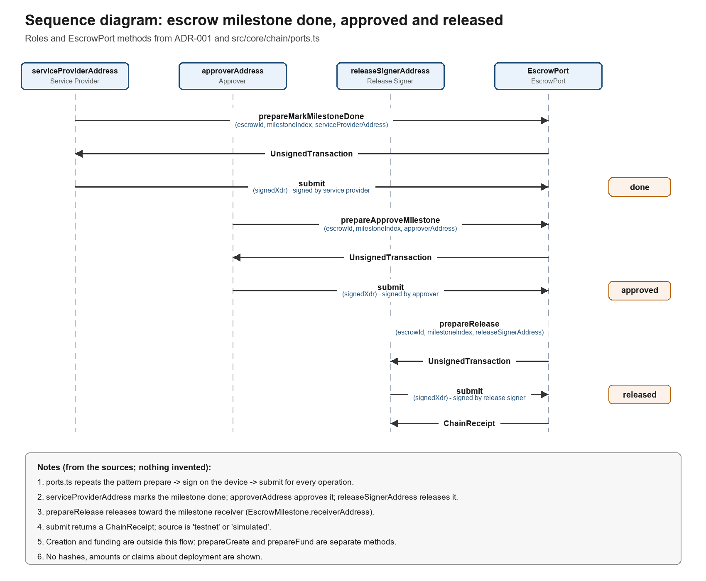

# Sequence diagram: escrow milestone done, approved and released

This diagram shows the three steps of an escrow milestone from `done` to `approved` to `released`. The participants and methods come only from ADR-001 and `src/core/chain/ports.ts`. Every step follows the pattern stated in the code: prepare an unsigned transaction, sign it on the person's device, then send it with `submit`.

## Elements

| Element | Kind | Source |
|---|---|---|
| `serviceProviderAddress` | participant (service provider) | `src/core/chain/ports.ts` |
| `approverAddress` | participant (approver) | `src/core/chain/ports.ts` |
| `releaseSignerAddress` | participant (release signer) | `src/core/chain/ports.ts` |
| `EscrowPort` | interface | `src/core/chain/ports.ts` |
| `prepareMarkMilestoneDone` | message (method) | `src/core/chain/ports.ts` |
| `prepareApproveMilestone` | message (method) | `src/core/chain/ports.ts` |
| `prepareRelease` | message (method) | `src/core/chain/ports.ts` |
| `submit` | message (method) | `src/core/chain/ports.ts` |
| `UnsignedTransaction` | return type | `src/core/chain/ports.ts` |
| `ChainReceipt` | return type | `src/core/chain/ports.ts` |
| `signedXdr` | parameter of `submit` | `src/core/chain/ports.ts` |
| `escrowId` | parameter | `src/core/chain/ports.ts` |
| `milestoneIndex` | parameter | `src/core/chain/ports.ts` |
| `done` | state (`MilestoneStatus`) | `src/core/chain/ports.ts` |
| `approved` | state (`MilestoneStatus`) | `src/core/chain/ports.ts` |
| `released` | state (`MilestoneStatus`) | `src/core/chain/ports.ts` |
| `MilestoneStatus` | type | `src/core/chain/ports.ts` |
| `EscrowMilestone` | type | `src/core/chain/ports.ts` |
| `receiverAddress` | field of `EscrowMilestone` | `src/core/chain/ports.ts` |
| `prepareCreate` | note (method) | `src/core/chain/ports.ts` |
| `prepareFund` | note (method) | `src/core/chain/ports.ts` |

## Notes

- The service provider marks the milestone done; the approver approves it; the release signer releases it.
- The three `submit` calls are signed by those roles in that order: service provider, approver, release signer.
- `prepareRelease` releases toward the milestone receiver (`EscrowMilestone.receiverAddress`).
- `submit` returns a `ChainReceipt` whose `source` is `testnet` or `simulated`.
- Creation and funding are outside this flow; they are separate `EscrowPort` methods (`prepareCreate` and `prepareFund`).
- The status labels are values of `MilestoneStatus`. No other states are drawn here.

## Sources

- [`src/core/chain/ports.ts`](../../src/core/chain/ports.ts)
- [`docs/adr/ADR-001-TRUSTLESS-WORK-ESCROW.md`](../adr/ADR-001-TRUSTLESS-WORK-ESCROW.md)
