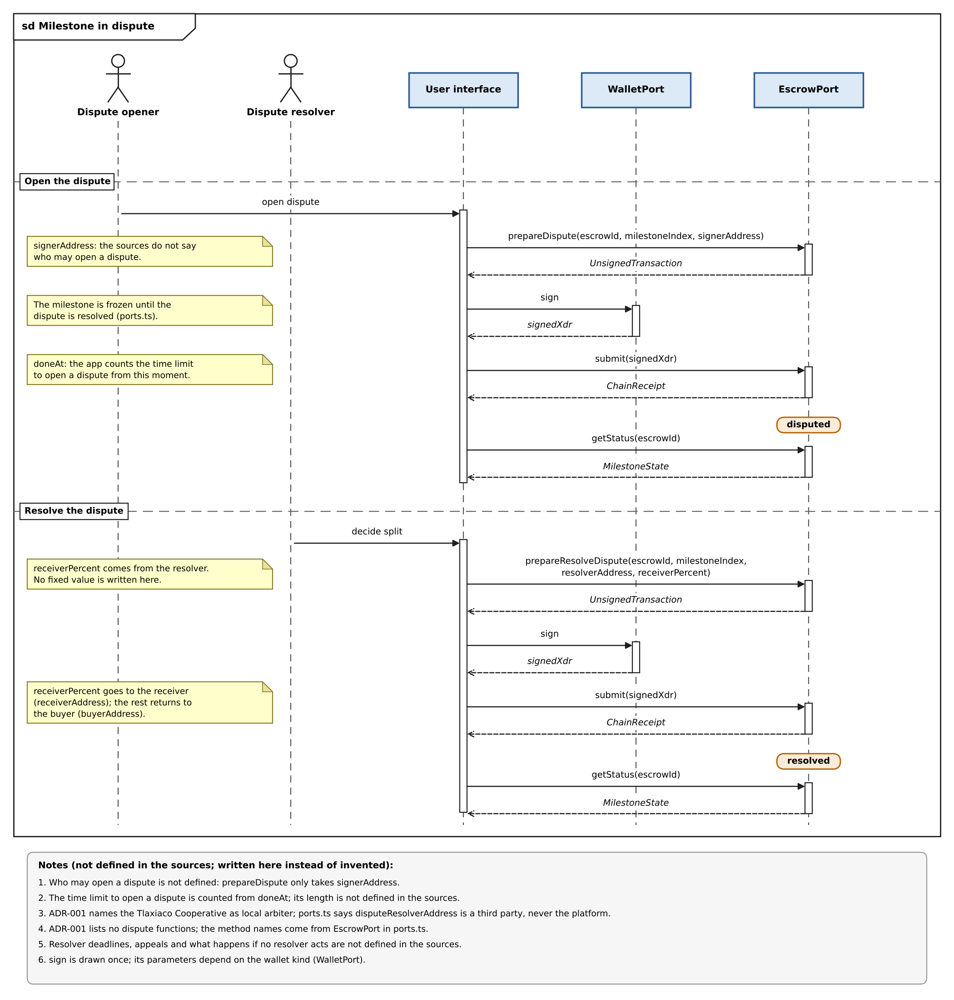

# Sequence diagram: milestone in dispute

This diagram shows how a dispute on an escrow milestone is opened and then resolved. Every operation follows the pattern prepare, sign, submit: the user interface asks `EscrowPort` to prepare an unsigned transaction, `WalletPort` signs it, and `EscrowPort` sends it. First `prepareDispute` freezes the milestone (`disputed`); then the resolver chooses `receiverPercent` and `prepareResolveDispute` closes it (`resolved`). No percentage is written in the diagram: `receiverPercent` comes from the resolver.

## Elements

| Element | Kind | Source |
|---|---|---|
| `Milestone in dispute` | interaction (frame `sd`) | this diagram |
| `Open the dispute` | section label | this diagram |
| `Resolve the dispute` | section label | this diagram |
| `Dispute opener` | participant (actor) | `src/core/chain/ports.ts` (`signerAddress`) |
| `Dispute resolver` | participant (actor) | `src/core/chain/ports.ts` (`disputeResolverAddress`) |
| `User interface` | participant | `src/core/chain/ports.ts` (header comment) |
| `WalletPort` | participant (interface) | `src/core/chain/ports.ts` |
| `EscrowPort` | participant (interface) | `src/core/chain/ports.ts` |
| `open dispute` | message (user action) | this diagram |
| `decide split` | message (user action) | this diagram |
| `prepareDispute` | message (method of `EscrowPort`) | `src/core/chain/ports.ts` |
| `prepareResolveDispute` | message (method of `EscrowPort`) | `src/core/chain/ports.ts` |
| `sign` | message (method of `WalletPort`) | `src/core/chain/ports.ts` |
| `submit` | message (method of `EscrowPort`) | `src/core/chain/ports.ts` |
| `getStatus` | message (method of `EscrowPort`) | `src/core/chain/ports.ts` |
| `escrowId` | parameter | `src/core/chain/ports.ts` |
| `milestoneIndex` | parameter | `src/core/chain/ports.ts` |
| `signerAddress` | parameter of `prepareDispute` | `src/core/chain/ports.ts` |
| `resolverAddress` | parameter of `prepareResolveDispute` | `src/core/chain/ports.ts` |
| `receiverPercent` | parameter of `prepareResolveDispute` | `src/core/chain/ports.ts` |
| `signedXdr` | parameter of `submit` and return of `sign` | `src/core/chain/ports.ts` |
| `UnsignedTransaction` | return type | `src/core/chain/ports.ts` |
| `ChainReceipt` | return type | `src/core/chain/ports.ts` |
| `MilestoneState` | return type | `src/core/chain/ports.ts` |
| `disputed` | state (`MilestoneStatus`) | `src/core/chain/ports.ts` |
| `resolved` | state (`MilestoneStatus`) | `src/core/chain/ports.ts` |
| `doneAt` | field of `MilestoneState` | `src/core/chain/ports.ts` |
| `receiverAddress` | field of `EscrowMilestone` | `src/core/chain/ports.ts` |
| `buyerAddress` | field of `CreateEscrowRequest` | `src/core/chain/ports.ts` |
| `disputeResolverAddress` | field of `CreateEscrowRequest` | `src/core/chain/ports.ts` |
| `Tlaxiaco Cooperative` | role named in a note | `docs/adr/ADR-001-TRUSTLESS-WORK-ESCROW.md` |

## Notes

- Who may open a dispute is not defined: `prepareDispute` only takes `signerAddress`.
- The time limit to open a dispute is counted from `doneAt`; its length is not defined in the sources.
- ADR-001 names the Tlaxiaco Cooperative as local arbiter; `ports.ts` says `disputeResolverAddress` is a third party, never the platform. The diagram uses the `ports.ts` wording.
- ADR-001 lists no dispute functions; the method names come from `EscrowPort` in `ports.ts`.
- Resolver deadlines, appeals and what happens if no resolver acts are not defined in the sources.
- `sign` is drawn once; its parameters depend on the wallet kind (`WalletPort`).
- `receiverPercent` goes to the receiver (`receiverAddress`) and the rest returns to the buyer (`buyerAddress`). It comes from the resolver, so no fixed value is written.

## Sources

- [`src/core/chain/ports.ts`](../../src/core/chain/ports.ts)
- [`docs/adr/ADR-001-TRUSTLESS-WORK-ESCROW.md`](../adr/ADR-001-TRUSTLESS-WORK-ESCROW.md)
