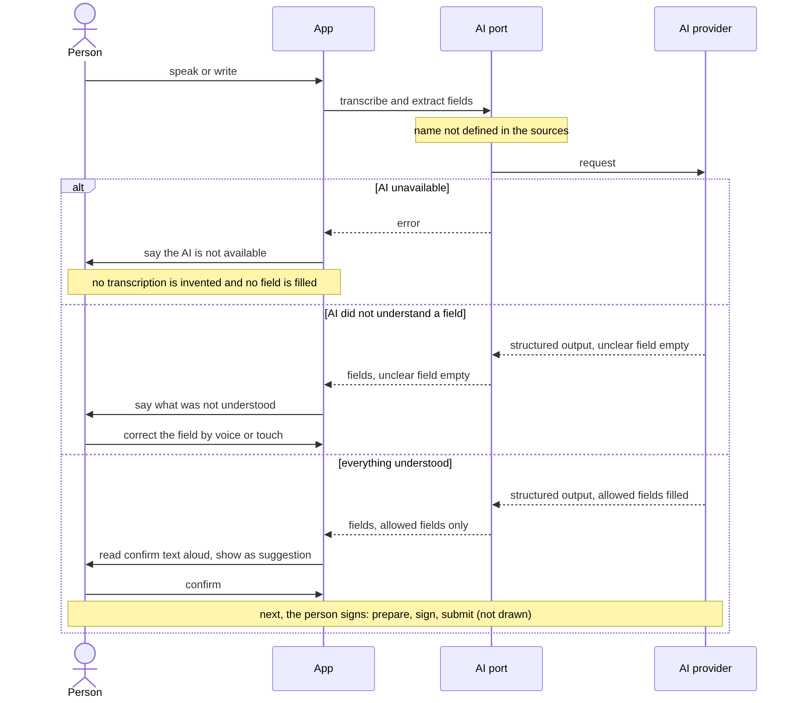

# Sequence diagram: the AI is not available or did not understand

This diagram shows what happens after a person speaks or writes in the chat and the app asks the AI to transcribe the input and fill the fields of the draft. An `alt` fragment has three operands: the AI is unavailable, the AI did not understand a field, and everything was understood. In every case the app says what happened. It never invents a transcription, and a field the AI did not understand stays empty. What the AI returns is shown as a suggestion; the person confirms and signs.

## Elements

| Element | Kind | Source |
|---|---|---|
| `Person` | participant (actor) | `docs/adr/ADR-007-MOTOR-DE-ATESTACIONES-POR-VOZ.md` (D2) |
| `App` | participant | `docs/adr/ADR-006-DATOS-FUERA-DE-LA-CADENA-E-IA.md` (D3, D4) |
| `AI port` | participant (interface) | `AGENTS.md` (rule 4), `docs/adr/ADR-006-DATOS-FUERA-DE-LA-CADENA-E-IA.md` (D2) |
| `AI provider` | participant | `docs/adr/ADR-006-DATOS-FUERA-DE-LA-CADENA-E-IA.md` (D2) |
| `alt` | combined fragment | this diagram |
| `AI unavailable` | operand (guard) | `docs/adr/ADR-006-DATOS-FUERA-DE-LA-CADENA-E-IA.md` (D4) |
| `AI did not understand a field` | operand (guard) | `docs/adr/ADR-006-DATOS-FUERA-DE-LA-CADENA-E-IA.md` (D3, D4) |
| `everything understood` | operand (guard) | `docs/adr/ADR-007-MOTOR-DE-ATESTACIONES-POR-VOZ.md` (D2) |
| `speak or write` | message (user action) | `docs/adr/ADR-007-MOTOR-DE-ATESTACIONES-POR-VOZ.md` (D2) |
| `transcribe and extract fields` | message | `docs/adr/ADR-006-DATOS-FUERA-DE-LA-CADENA-E-IA.md` (D2) |
| `request` | message | this diagram |
| `error` | message (return) | `docs/adr/ADR-006-DATOS-FUERA-DE-LA-CADENA-E-IA.md` (D2: "text and its language, or an error") |
| `say the AI is not available` | message | `docs/adr/ADR-006-DATOS-FUERA-DE-LA-CADENA-E-IA.md` (D4), `AGENTS.md` (rule 9) |
| `structured output, unclear field empty` | message (return) | `docs/adr/ADR-007-MOTOR-DE-ATESTACIONES-POR-VOZ.md` (D2, step 3) |
| `fields, unclear field empty` | message (return) | `docs/adr/ADR-006-DATOS-FUERA-DE-LA-CADENA-E-IA.md` (D3, step 3) |
| `say what was not understood` | message | `docs/adr/ADR-006-DATOS-FUERA-DE-LA-CADENA-E-IA.md` (D4) |
| `correct the field by voice or touch` | message (user action) | `docs/adr/ADR-006-DATOS-FUERA-DE-LA-CADENA-E-IA.md` (D3, step 4) |
| `structured output, allowed fields filled` | message (return) | `docs/adr/ADR-007-MOTOR-DE-ATESTACIONES-POR-VOZ.md` (D2, step 3) |
| `fields, allowed fields only` | message (return) | `docs/adr/ADR-007-MOTOR-DE-ATESTACIONES-POR-VOZ.md` (D1, D2) |
| `read confirm text aloud, show as suggestion` | message | `docs/adr/ADR-007-MOTOR-DE-ATESTACIONES-POR-VOZ.md` (D2 step 4, D3) |
| `confirm` | message (user action) | `docs/adr/ADR-007-MOTOR-DE-ATESTACIONES-POR-VOZ.md` (D2, step 4) |
| `name not defined in the sources` | note | see Notes |
| `no transcription is invented and no field is filled` | note | `AGENTS.md` (rule 9) |
| `next, the person signs: prepare, sign, submit (not drawn)` | note | `docs/adr/ADR-007-MOTOR-DE-ATESTACIONES-POR-VOZ.md` (D2, step 5) |

## Notes

- The name of the AI port is not defined. ADR-006 (D2) gives `AssistantPort` only as an example, and `AGENTS.md` says the AI ports are still to come (#154, #156, #157). The diagram uses the generic name `AI port`.
- ADR-006 (D2) says the UI uses a port in `src/core/` and that each job has an adapter per provider on the server. The server and its adapter are not drawn because the sources do not define their names for this flow.
- `AI provider` is the generic name for the service behind the port. Today the code uses Gemini; the diagram does not name it because the provider is still being chosen (ADR-006, D6).
- ADR-006 (D4) uses one message for both failures: "No te escuché bien. ¿Lo intentamos otra vez o lo escribes?". The sources do not define a separate text for each operand, so the diagram only says what the app tells the person.
- Which field is reported as not understood, and whether the app asks again by voice or by touch, is not defined beyond "correct each field with voice or finger" (ADR-006, D3).
- The sources do not say what happens to the audio when the AI is unavailable. They only say the audio is transcribed and then deleted (ADR-006, D5), and that without signal it is kept on the phone only until it is transcribed.
- Fields marked `forbidden` in the manifest are discarded by the extractor (ADR-007, D1 and D2). This is not drawn as a separate step.
- The signing step (prepare, sign on the phone, submit with `AttestationPort`) is outside this diagram.
- The current code still returns invented text when Gemini is missing (ADR-006, section 1). The diagram shows the behavior the ADRs and `AGENTS.md` require, not the current code.

## Sources

- [`docs/adr/ADR-007-MOTOR-DE-ATESTACIONES-POR-VOZ.md`](../adr/ADR-007-MOTOR-DE-ATESTACIONES-POR-VOZ.md)
- [`docs/adr/ADR-006-DATOS-FUERA-DE-LA-CADENA-E-IA.md`](../adr/ADR-006-DATOS-FUERA-DE-LA-CADENA-E-IA.md)
- [`AGENTS.md`](../../AGENTS.md)
