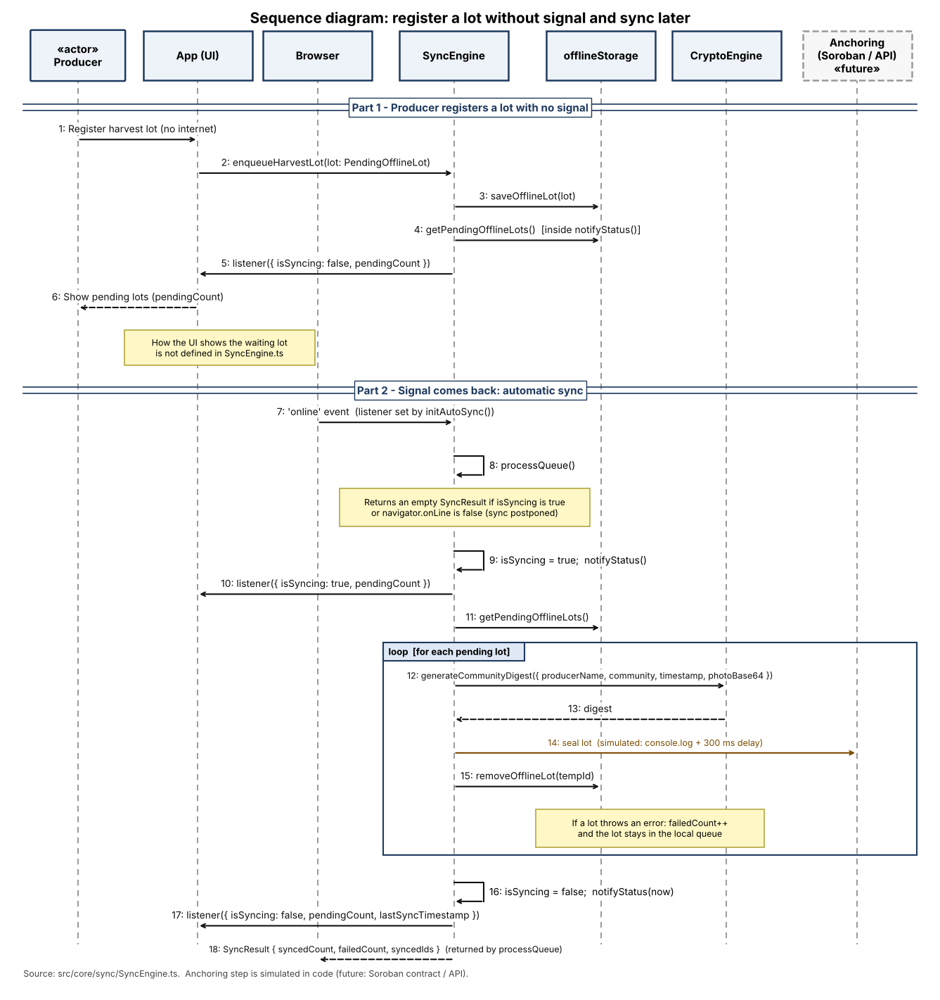

# Sequence diagram: register a lot without signal and sync later

This diagram shows what happens when a producer registers a harvest lot with no internet. The app saves the lot in local storage through `SyncEngine.enqueueHarvestLot` and notifies its listeners with the number of pending lots. When the browser fires the `online` event, `SyncEngine` processes the queue: it computes a digest for each lot, seals it (this step is only simulated in the code) and removes it from the local queue.

## Elements

| Element | Type | Description |
|---|---|---|
| Producer | Actor | Person who registers the lot with no signal. |
| App (UI) | Participant | Screen that calls `enqueueHarvestLot` and receives the status listener calls. The component name and how it shows the waiting lot are not defined in `SyncEngine.ts` (noted in the diagram). |
| Browser | Participant | Fires the `online` event when the connection comes back. |
| SyncEngine | Class | Offline sync queue (`src/core/sync/SyncEngine.ts`). |
| offlineStorage | Participant | Local storage helpers used by `SyncEngine`. |
| CryptoEngine | Class | Computes the digest of each lot. |
| Anchoring (Soroban / API) | Participant (*future*) | Seals the lot. In the code this step is simulated (`console.log` and a 300 ms delay). |
| enqueueHarvestLot(lot: PendingOfflineLot) | Method | Saves a new lot in the local queue and notifies status. |
| saveOfflineLot(lot) | Function | Stores the lot locally. |
| getPendingOfflineLots() | Function | Reads the lots still waiting to be sent. |
| listener({ isSyncing, pendingCount, lastSyncTimestamp }) | Callback | Status sent to every subscribed listener (`SyncStatusListener`). |
| initAutoSync() | Method | Registers the `online` event listener. |
| processQueue() | Method | Syncs the queue; returns an empty `SyncResult` if `isSyncing` is true or `navigator.onLine` is false. |
| generateCommunityDigest({ producerName, community, timestamp, photoBase64 }) | Method | Returns the digest of the lot. |
| removeOfflineLot(tempId) | Function | Removes the lot from the local queue after it is sealed. |
| notifyStatus() | Method | Reads pending lots and calls the listeners. |
| isSyncing | State | `true` while `processQueue` runs, `false` otherwise. |
| pendingCount | State | Number of lots waiting to be sent. |
| lastSyncTimestamp | State | Time of the last finished sync. |
| failedCount | State | Lots that threw an error; they stay in the local queue. |
| SyncResult { syncedCount, failedCount, syncedIds } | Type | Value returned by `processQueue`. |

## Sources

- `src/core/sync/SyncEngine.ts`
