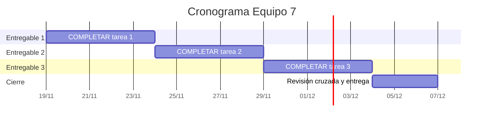

# Propuesta final · Equipo 7 · Sprint 4

Subedición de [#203](https://github.com/Open-Hub-Tec/yucu-protocol/issues/203). Módulo del equipo: [#116](https://github.com/Open-Hub-Tec/yucu-protocol/issues/116). Entrega de la Actividad 1, Unidad 4, TecNM Campus Tlaxiaco.

Integrantes: @usuario1, @usuario2, @usuario3, @usuario4 *(COMPLETAR con los `@usuario` de GitHub; sin nombres completos ni números de control)*.

> **Antes de abrir el PR:** busca todos los `COMPLETAR` de este archivo y bórralos junto con las notas en cursiva. Los tres montos y fechas del resumen deben ser idénticos a los de las secciones 5 y 6.

## Resumen ejecutivo

*(Media página. Costo y fecha iguales a las secciones 5 y 6.)*

**Problema.** Las personas artesanas de tenates de palma de Tlaxiaco, Oaxaca, dependen de intermediarios para vender, tienen poca visibilidad fuera de su comunidad y encuentran difícil fijar un precio que cubra materia prima y tiempo de elaboración.

**Solución.** Construir el módulo [#116](https://github.com/Open-Hub-Tec/yucu-protocol/issues/116) de Yucu Protocol: COMPLETAR (una frase con lo que hace el módulo, tomada del issue #116). Funciona sobre Stellar **testnet** como prototipo.

**A quién beneficia.** A artesanas y artesanos de tenates de palma de Tlaxiaco y a compradores que quieren comprar con claridad sobre el origen del producto.

**Costo total.** $COMPLETAR MXN (COMPLETAR horas), igual que en la sección 6.

**Fecha de entrega.** COMPLETAR (dd de mes de 2026), igual que en la sección 5.

## Problema y contexto

*(Problema real de la organización con evidencia de campo: citas sin nombre, cifras, observaciones.)*

**Contexto.** Yucu Protocol es una PWA para que productores y artesanas de la Mixteca registren sus lotes, prueben su origen y vendan sin intermediarios. Es un prototipo desarrollado por estudiantes del TecNM Campus Tlaxiaco.

**Problema identificado por el equipo.** Según nuestra investigación sobre los tenates de palma de Tlaxiaco ([documento del equipo](../../research/field-interviews/tenates-palma-tlaxiaco-equipo7.md)):

- Dependencia de intermediarios para vender.
- Dificultad para fijar un precio justo.
- Falta de canales de venta digitales y poco acceso a nuevos clientes.
- Diferencia entre el precio que recibe la persona artesana y el precio final al comprador.

**Evidencia de campo.** *(COMPLETAR. Solo rol y comunidad, nunca nombres. Ejemplos de formato:)*

| # | Fuente (rol y comunidad) | Cita o dato sin nombre | Dónde se guarda el registro |
|---|---|---|---|
| 1 | artesana de tenates, Tlaxiaco | «COMPLETAR cita textual» | resumen en `docs/research/…`; audio en carpeta privada del equipo |
| 2 | COMPLETAR | COMPLETAR cifra u observación (precio de venta, horas por pieza, costo de la palma) | COMPLETAR |
| 3 | COMPLETAR | COMPLETAR | COMPLETAR |

*Si alguna cifra es una estimación del equipo y no un dato medido, escríbelo así.*

## Objetivo SMART y alcance

**Objetivo SMART.** *(Las cinco letras, con cifra y fecha. Toma la versión del Sprint 3 y no la cambies.)*

- **S (específico):** COMPLETAR qué se logra, para quién, con qué módulo.
- **M (medible):** COMPLETAR cifra (por ejemplo, N pruebas que pasan, N pantallas funcionando, N usuarios de prueba).
- **A (alcanzable):** COMPLETAR por qué es posible con las horas y el equipo de la sección 6.
- **R (relevante):** COMPLETAR relación con el problema de la sección 2 y con el módulo #116.
- **T (con fecha):** COMPLETAR dd de mes de 2026.

**El módulo incluye:**

- COMPLETAR (funciones concretas de #116)
- COMPLETAR
- COMPLETAR

**El módulo no incluye:**

- Despliegue en mainnet ni dinero real: todo corre en testnet.
- Auditoría de contratos.
- Certificaciones de calidad, orgánico o comercio justo.
- COMPLETAR otras exclusiones del equipo.

## Solución y uso de Stellar

**Qué se construye.** COMPLETAR (descripción del módulo #116 en 3 a 5 frases, sin prometer ventas ni ingresos).

**Por qué Stellar ayuda.** *(COMPLETAR con las razones del equipo; punto de partida basado en el diseño del proyecto:)*

- La persona artesana puede cobrar en pesos sin ver nada de cripto (ver [ADR-004](../../adr/ADR-004-PAGOS-EN-PESOS-SIN-BILLETERA.md)).
- Las comisiones de red son bajas, lo que importa en ventas de montos pequeños.
- El pasaporte del lote y las atestaciones dejan un registro que cualquiera puede revisar.
- Cada transacción la firma la persona en su dispositivo; el servidor no guarda llaves ni retiene fondos.

**Qué es real, qué es demostración y qué está pendiente.** El estado de cada parte del proyecto está en la tabla [Implementation status](../../../README.md#implementation-status) del `README.md`. Para nuestro módulo:

| Parte | Estado | Detalle |
|---|---|---|
| COMPLETAR (por ejemplo, pantalla del módulo) | COMPLETAR (real / demostración / pendiente) | COMPLETAR |
| COMPLETAR (por ejemplo, escrow) | COMPLETAR | El escrow real es Trustless Work; el adaptador actual guarda datos en memoria (simulado) según el README |
| COMPLETAR | COMPLETAR | COMPLETAR |

Todo corre en Stellar **testnet**; los contratos no han sido auditados.

## Plan de trabajo y cronograma

**Entregables.** *(Uno por fila: qué se entrega, cómo se comprueba, fecha y responsable.)*

| # | Entregable | Cómo se comprueba | Fecha | Responsable |
|---|---|---|---|---|
| E1 | COMPLETAR | COMPLETAR (prueba, revisión de PR, demo) | COMPLETAR | @usuario |
| E2 | COMPLETAR | COMPLETAR | COMPLETAR | @usuario |
| E3 | COMPLETAR | COMPLETAR | COMPLETAR | @usuario |
| E4 | COMPLETAR | COMPLETAR | COMPLETAR | @usuario |

**Cronograma.** *(Ajusta tareas y fechas; la última fecha debe ser la del resumen.)*

## Presupuesto y personal

*(Horas, tarifa y costo por entregable, más el costo de la calidad del Sprint 2. El total debe coincidir con el resumen y con lo que se dice en la sección 5.)*

**Tarifa por hora:** $COMPLETAR MXN *(la usada en las estimaciones del Sprint 3)*.

| Entregable | Horas | Tarifa | Costo |
|---|---|---|---|
| E1 | COMPLETAR | COMPLETAR | COMPLETAR |
| E2 | COMPLETAR | COMPLETAR | COMPLETAR |
| E3 | COMPLETAR | COMPLETAR | COMPLETAR |
| E4 | COMPLETAR | COMPLETAR | COMPLETAR |
| Costo de la calidad (Sprint 2: prevención, evaluación, fallas) | COMPLETAR | COMPLETAR | COMPLETAR |
| **Total** | **COMPLETAR** | | **$COMPLETAR MXN** |

**Horas por integrante** *(deben sumar el total de arriba)*:

| Integrante | Horas |
|---|---|
| @usuario1 | COMPLETAR |
| @usuario2 | COMPLETAR |
| @usuario3 | COMPLETAR |
| @usuario4 | COMPLETAR |
| **Total** | **COMPLETAR** |

## Riesgos y viabilidad

**Dictamen:** COMPLETAR (**Go**, **Go condicionado** o **No-Go**), el mismo del Sprint 3.

**Justificación.** COMPLETAR: compara el costo total ($COMPLETAR MXN) con un financiamiento realista (por ejemplo, el rango que pueden obtener de Drips Wave u otra fuente que el equipo pueda sustentar). No prometer ingresos ni ventas.

**Riesgos.** *(Mínimo tres, en formato «si… entonces…». Probabilidad, impacto y dueño son propuestas: confirma o cambia con tu matriz del Sprint 3.)*

| # | Riesgo (si… entonces…) | Probabilidad | Impacto | Respuesta | Dueño |
|---|---|---|---|---|---|
| R1 | Si las implementaciones reales de los puertos de Stellar y Trustless Work no están listas a tiempo, entonces nuestro módulo tendría que seguir usando la versión de demostración. | COMPLETAR | COMPLETAR | Construir sobre los puertos (`src/core/chain/`) y marcar lo simulado con `source: 'simulated'` y `<DemoBadge />`. | @usuario |
| R2 | Si no conseguimos más entrevistas de campo con personas artesanas, entonces la evidencia del problema seguirá siendo limitada. | COMPLETAR | COMPLETAR | Programar visitas con fecha y registrar cada una en resumen anonimizado. | @usuario |
| R3 | Si un integrante deja de tener horas disponibles, entonces un entregable se retrasa. | COMPLETAR | COMPLETAR | Dos personas conocen cada entregable; revisión cruzada de PR. | @usuario |
| R4 | Si se publica por error un dato personal de una persona entrevistada, entonces se viola su privacidad y el dato queda en el historial de git. | COMPLETAR | COMPLETAR | Revisar la lista de [PRIVACIDAD.md](../../research/PRIVACIDAD.md) antes de cada PR. | @usuario |

## Evidencia y siguientes pasos

**Evidencia que se puede revisar.**

| Evidencia | Enlace o estado |
|---|---|
| Registro de entrevistas (resumen sin datos personales) | [`tenates-palma-tlaxiaco-equipo7.md`](../../research/field-interviews/tenates-palma-tlaxiaco-equipo7.md) y COMPLETAR otros resúmenes |
| Historias de usuario (Sprint 1) | COMPLETAR enlace |
| Plan de Calidad y costo de la calidad (Sprint 2) | COMPLETAR enlace |
| Objetivo SMART, estimaciones, matriz de riesgos y dictamen (Sprint 3) | COMPLETAR enlace |
| Prototipo / código del módulo | COMPLETAR enlace a rama o PR del repositorio |
| Carta de entendimiento con la organización | COMPLETAR estado (sin firmar / en revisión / firmada) |

**Ética y datos personales.** Este documento no incluye nombres, voces, fotos, teléfonos ni números de control de personas de la comunidad. Las evidencias con datos personales se guardan fuera del repositorio, según el [aviso de privacidad](../../research/PRIVACIDAD.md). Este documento no promete ventas, ingresos ni certificaciones. Yucu Protocol es un prototipo en testnet, con contratos sin auditar.

**Siguientes pasos.**

| Paso | Fecha | Responsable |
|---|---|---|
| COMPLETAR | COMPLETAR | @usuario |
| COMPLETAR | COMPLETAR | @usuario |
| COMPLETAR | COMPLETAR | @usuario |
